<picture><source media="(prefers-color-scheme: dark)" srcset="assets/hero-dark.svg"><source media="(prefers-color-scheme: light)" srcset="assets/hero-light.svg"></picture>

**I build security tools, AI-agent infrastructure and full-stack products, and I ship every one as something you can click.**

[Portfolio](https://portfolio-general-ten.vercel.app) · [LinkedIn](https://www.linkedin.com/in/sodagum-venkata-kaushik-3497a4248/) · [X](https://x.com/svKaushik2210) · [All repos](https://github.com/Kaushik2210?tab=repositories)

## ▦ Shipped, square by square

Ten projects I'd hand to a hiring manager. Each card carries its own heatmap: one square per day, last 26 weeks.

<table>
<tr><td width="50%" valign="top"><a href="https://kaushik2210.github.io/IntentGuard/"><picture><source media="(prefers-color-scheme: dark)" srcset="assets/p-intentguard-dark.svg"><source media="(prefers-color-scheme: light)" srcset="assets/p-intentguard-light.svg"></picture></a> <a href="https://github.com/Kaushik2210/IntentGuard">source</a> · <a href="https://kaushik2210.github.io/IntentGuard/">live demo</a></td><td width="50%" valign="top"><a href="https://github.com/Kaushik2210/Net-Sentinel"><picture><source media="(prefers-color-scheme: dark)" srcset="assets/p-net-sentinel-dark.svg"><source media="(prefers-color-scheme: light)" srcset="assets/p-net-sentinel-light.svg"></picture></a> <a href="https://github.com/Kaushik2210/Net-Sentinel">source</a></td></tr>
<tr><td width="50%" valign="top"><a href="https://github.com/Kaushik2210/ORBITAL-SENTINEL"><picture><source media="(prefers-color-scheme: dark)" srcset="assets/p-orbital-sentinel-dark.svg"><source media="(prefers-color-scheme: light)" srcset="assets/p-orbital-sentinel-light.svg"></picture></a> <a href="https://github.com/Kaushik2210/ORBITAL-SENTINEL">source</a></td><td width="50%" valign="top"><a href="https://github.com/Kaushik2210/Deepfake-Detector"><picture><source media="(prefers-color-scheme: dark)" srcset="assets/p-deepfake-detector-dark.svg"><source media="(prefers-color-scheme: light)" srcset="assets/p-deepfake-detector-light.svg"></picture></a> <a href="https://github.com/Kaushik2210/Deepfake-Detector">source</a></td></tr>
<tr><td width="50%" valign="top"><a href="https://tapwire-xi.vercel.app"><picture><source media="(prefers-color-scheme: dark)" srcset="assets/p-tapwire-dark.svg"><source media="(prefers-color-scheme: light)" srcset="assets/p-tapwire-light.svg"></picture></a> <a href="https://github.com/Kaushik2210/tapwire">source</a> · <a href="https://tapwire-xi.vercel.app">live demo</a></td><td width="50%" valign="top"><a href="https://kaushik2210.github.io/gitVisualise/"><picture><source media="(prefers-color-scheme: dark)" srcset="assets/p-gitvisualise-dark.svg"><source media="(prefers-color-scheme: light)" srcset="assets/p-gitvisualise-light.svg"></picture></a> <a href="https://github.com/Kaushik2210/gitVisualise">source</a> · <a href="https://kaushik2210.github.io/gitVisualise/">live demo</a></td></tr>
<tr><td width="50%" valign="top"><a href="https://hireos-beryl.vercel.app"><picture><source media="(prefers-color-scheme: dark)" srcset="assets/p-hireos-dark.svg"><source media="(prefers-color-scheme: light)" srcset="assets/p-hireos-light.svg"></picture></a> <a href="https://github.com/Kaushik2210/HireOS">source</a> · <a href="https://hireos-beryl.vercel.app">live demo</a></td><td width="50%" valign="top"><a href="https://algoverse-lovat-seven.vercel.app"><picture><source media="(prefers-color-scheme: dark)" srcset="assets/p-algoverse-dark.svg"><source media="(prefers-color-scheme: light)" srcset="assets/p-algoverse-light.svg"></picture></a> <a href="https://github.com/Kaushik2210/AlgoVerse">source</a> · <a href="https://algoverse-lovat-seven.vercel.app">live demo</a></td></tr>
<tr><td width="50%" valign="top"><a href="https://github.com/Kaushik2210/scam-khel"><picture><source media="(prefers-color-scheme: dark)" srcset="assets/p-scam-khel-dark.svg"><source media="(prefers-color-scheme: light)" srcset="assets/p-scam-khel-light.svg"></picture></a> <a href="https://github.com/Kaushik2210/scam-khel">source</a></td><td width="50%" valign="top"><a href="https://github.com/Kaushik2210/aiforge"><picture><source media="(prefers-color-scheme: dark)" srcset="assets/p-aiforge-dark.svg"><source media="(prefers-color-scheme: light)" srcset="assets/p-aiforge-light.svg"></picture></a> <a href="https://github.com/Kaushik2210/aiforge">source</a></td></tr>
</table>

## ▦ My year, alive

<picture><source media="(prefers-color-scheme: dark)" srcset="assets/year-dark.svg"><source media="(prefers-color-scheme: light)" srcset="assets/year-light.svg"></picture>

Frame 0 is my real calendar. Then every square follows Conway's Game of Life: survivors get brighter, newborns start dim, crowded squares go dark. Then it loops back to the real year.

## ▦ What it's built with

<picture><source media="(prefers-color-scheme: dark)" srcset="assets/stack-dark.svg"><source media="(prefers-color-scheme: light)" srcset="assets/stack-light.svg"></picture>

**Toolbox:** React · Next.js · Node · FastAPI · Supabase · Tailwind · Docker · Zeek & Suricata · MITRE ATT&CK · LLM agents & tool calling · Chrome extensions · GitHub Actions

## ▦ Work with me

<a href="https://www.linkedin.com/in/sodagum-venkata-kaushik-3497a4248/"><picture><source media="(prefers-color-scheme: dark)" srcset="assets/hire-dark.svg"><source media="(prefers-color-scheme: light)" srcset="assets/hire-light.svg"></picture></a>

**Have a project?** [Message me on LinkedIn](https://www.linkedin.com/in/sodagum-venkata-kaushik-3497a4248/) or [see the portfolio](https://portfolio-general-ten.vercel.app).

Every square on this page is drawn from live GitHub data by <a href="scripts/build.py">one Python script</a> and redrawn every 6 hours.

