<div align="center">


<sub>The sky above my skyline is Bangalore's real sky right now: live time of day and weather, redrawn through the day. Come back at sunset.</sub>

**I build security tooling and AI-era developer products, then ship them as live demos.**

<a href="https://portfolio-general-ten.vercel.app">Portfolio</a> &nbsp;·&nbsp; <a href="https://www.linkedin.com/in/sodagum-venkata-kaushik-3497a4248/">LinkedIn</a> &nbsp;·&nbsp; <a href="https://x.com/svKaushik2210">X</a> &nbsp;·&nbsp; <a href="https://github.com/Kaushik2210?tab=repositories">Repositories</a> &nbsp;·&nbsp; <a href="https://github.com/Kaushik2210/Kaushik2210/issues/new?template=hello.yml">Say hello</a>

<sub><a href="#work">Work</a> &nbsp;›&nbsp; <a href="#activity">Activity</a> &nbsp;›&nbsp; <a href="#interactive">Interactive</a> &nbsp;›&nbsp; <a href="#canvas">Canvas</a></sub>

<sub>Try it: <a href="#canvas">paint a pixel</a> &nbsp;·&nbsp; <a href="https://badger.github.io/virtual/?u=Kaushik2210">play on my badge</a> &nbsp;·&nbsp; <a href="#interactive">crack the CTF</a> &nbsp;·&nbsp; <a href="https://github.com/Kaushik2210/Kaushik2210/issues/new?template=hello.yml">say hello</a></sub>

<br/>

<a href="https://github.com/Kaushik2210?tab=repositories"></a>

<!--NOW_START-->
**Now:** shipping [aiforge](https://github.com/Kaushik2210/aiforge) (TypeScript, pushed today). Open-source, gamified academy for becoming a production-ready AI engineer
<!--NOW_END-->

</div>

<div align="center">

## Work


</div>

<table width="100%">
<tr>
<td width="33%" valign="top">

**Security that shows its work**

Detection systems that explain themselves. [Net-Sentinel](https://github.com/Kaushik2210/Net-Sentinel) maps attacks to MITRE ATT&CK, [ORBITAL-SENTINEL](https://github.com/Kaushik2210/ORBITAL-SENTINEL) tells cyberattacks from sensor faults in spacecraft telemetry, [Deepfake-Detector](https://github.com/Kaushik2210/Deepfake-Detector) returns calibrated probabilities instead of a verdict, and [scam-khel](https://github.com/Kaushik2210/scam-khel) shields families from digital-arrest scams.

</td>
<td width="33%" valign="top">

**Tools for the AI-agent era**

Guardrails and visibility for people building with agents. [tapwire](https://github.com/Kaushik2210/tapwire) turns an agent's mistakes into enforced rules and measures how often they repeat, [gitVisualise](https://github.com/Kaushik2210/gitVisualise) turns any repo into a narrated architecture tour (site, CLI and GitHub Action), and [PORTCULLIS](https://github.com/Kaushik2210/PORTCULLIS) screens LLM apps for prompt injection.

</td>
<td width="33%" valign="top">

**Products that ship**

Things people can open and use today. [HireOS](https://hireos-beryl.vercel.app) is a job-search workspace that shows its evidence, [AlgoVerse](https://algoverse-lovat-seven.vercel.app) is interview prep with 635+ explained solutions, and [Overrank](https://overrank.vercel.app) runs a live campus leaderboard.

</td>
</tr>
</table>

<div align="center">


</div>

<!--BUILDS_START-->
<div align="center">

<a href="https://github.com/Kaushik2210/Net-Sentinel"></a> <a href="https://github.com/Kaushik2210/ORBITAL-SENTINEL"></a> <a href="https://github.com/Kaushik2210/scam-khel"></a> <a href="https://github.com/Kaushik2210/Deepfake-Detector"></a> <a href="https://kaushik2210.github.io/IntentGuard/"></a> <a href="https://tapwire-xi.vercel.app"></a> <a href="https://kaushik2210.github.io/gitVisualise/"></a> <a href="https://hireos-beryl.vercel.app"></a> <a href="https://algoverse-lovat-seven.vercel.app"></a>

<sub>Tap a card to open the live demo or the repository. Cover art is generated from each repo's name; language, stars and last push update automatically.</sub>

</div>

<details>
<summary><b>More builds (20)</b></summary>

**Security & AI**

| Build | Stack | What it is |
|:--|:--|:--|
| [**PORTCULLIS**](https://github.com/Kaushik2210/PORTCULLIS) | `Python` | Adversarial prompt injection detection gateway for LLM applications |
| [**ATTESTA**](https://github.com/Kaushik2210/ATTESTA---AI-powered-SOC-) | `TypeScript` | Multi-tenant Autonomous SOC platform with reproducible, re-adjudicable verdicts — a deterministic… |
| [**SCRB Crime Intelligence Analytics**](https://github.com/Kaushik2210/SCRB-Crime-Intelligence-Analytics-Platform) | `JavaScript` | An AI-driven crime analytics and visualization platform for the Karnataka State Police State Crime Records… |
| [**SafeRoute**](https://github.com/Kaushik2210/SafeRoute) | `JavaScript` | Safe-route app for women's safety, built with React and Vite. |
| [**SafePath**](https://github.com/Kaushik2210/SafePath) | `TypeScript` | Safe-path detector for women's safety, built in Google AI Studio with Firebase and TypeScript. |

**Web & product experiments**

| Build | Stack | What it is |
|:--|:--|:--|
| [**Overrank**](https://github.com/Kaushik2210/Overrank) · [live](https://overrank.vercel.app) | `TypeScript` | Live house-competition platform for campuses: teams earn points, the leaderboard reacts in real time, faculty… |
| [**GLYPHFORGE**](https://github.com/Kaushik2210/GLYPHFORGE) · [live](https://glyphforge-web.vercel.app) | `TypeScript` | A GPU-native ASCII art engine for the browser. Converts photos into character grids via perceptual… |
| [**Research-Visualizer**](https://github.com/Kaushik2210/Research-Visualizer) | `TypeScript` | Research-paper visualiser with rich visual representations, built with Google AI Studio and Gemini 3.0. |
| [**Celeb-Bomb**](https://github.com/Kaushik2210/Celeb-Bomb) | `TypeScript` | Web app that generates a selfie or image with a celebrity at random, built with Google AI Studio and Gemini… |
| [**Photo-Video-Editor**](https://github.com/Kaushik2210/Photo-Video-Editor) | `TypeScript` | Web app for editing images and videos, built with Google AI Studio and Gemini 3.0. |
| [**cybernetics_website**](https://github.com/Kaushik2210/cybernetics_website) | `HTML` | Website for the Cybernetics Association, 2024-25. |
| [**website_anime_design**](https://github.com/Kaushik2210/website_anime_design) | `JavaScript` | Fully responsive website featuring a 3D animated anime character with transitions. |

**Learning & practice**

| Build | Stack | What it is |
|:--|:--|:--|
| [**daily-automation-scripts**](https://github.com/Kaushik2210/daily-automation-scripts) | `Python` | 30-day challenge: 300 small, tested, cross-platform automation scripts in Python (files, PDFs, GitHub, email… |
| [**100-days-of-java**](https://github.com/Kaushik2210/100-days-of-java) | `Java` | 100 days of Java: from Hello World to data structures, algorithms and interview prep. Daily notes plus… |
| [**Learn Python**](https://github.com/Kaushik2210/Learn_python-) | `Python` | Python course as Jupyter notebooks: explanations, 108 challenge problems, exam prep and projects, from zero… |
| [**learn-os**](https://github.com/Kaushik2210/learn-os) | `TypeScript` | A gamified, interactive Operating Systems learning platform — from first principles to interview-ready… |
| [**cp-sysdesign-academy**](https://github.com/Kaushik2210/cp-sysdesign-academy) | `MDX` | Open-source interactive course: competitive programming and system design (static site, runs in the browser) |
| [**PowerBI-dashboard**](https://github.com/Kaushik2210/PowerBI-dashboard) | `misc` | Power BI dashboard for class attendance reporting. |

**More**

| Build | Stack | What it is |
|:--|:--|:--|
| [**aiforge**](https://github.com/Kaushik2210/aiforge) | `TypeScript` | Open-source, gamified academy for becoming a production-ready AI engineer |
| [**leetcode-study-studio**](https://github.com/Kaushik2210/leetcode-study-studio) | `JavaScript` | Chrome extension: LeetCode themes plus a learning layer (blind mode, hint ladder, spaced repetition, mistake… |

</details>
<!--BUILDS_END-->

<div align="center">

## Activity


<a href="https://github.com/Kaushik2210?tab=repositories"></a>

<sub>Rebuilt from my avatar on every run. The numbers beside it come straight from the GitHub API.</sub>


<a href="https://github.com/Kaushik2210?tab=repositories&sort=created"></a>

<sub>Every project I started this year, plotted like a launch. The higher it flies, the longer I kept building it. Green rings are live, gold is still in orbit.</sub>

<div align="center">

## Interactive

<a name="canvas"></a>


</div>

<!--CANVAS_START-->
<div align="center">

**An r/place-style canvas the whole internet paints together.** Click any pixel, pick a colour, press *Create*. A bot paints it within a minute.

<p><a href="https://github.com/Kaushik2210/Kaushik2210/issues/new?template=paint.yml&title=%5BPAINT%5D%20A1"></a><a href="https://github.com/Kaushik2210/Kaushik2210/issues/new?template=paint.yml&title=%5BPAINT%5D%20B1"></a><a href="https://github.com/Kaushik2210/Kaushik2210/issues/new?template=paint.yml&title=%5BPAINT%5D%20C1"></a><a href="https://github.com/Kaushik2210/Kaushik2210/issues/new?template=paint.yml&title=%5BPAINT%5D%20D1"></a><a href="https://github.com/Kaushik2210/Kaushik2210/issues/new?template=paint.yml&title=%5BPAINT%5D%20E1"></a><a href="https://github.com/Kaushik2210/Kaushik2210/issues/new?template=paint.yml&title=%5BPAINT%5D%20F1"></a><a href="https://github.com/Kaushik2210/Kaushik2210/issues/new?template=paint.yml&title=%5BPAINT%5D%20G1"></a><a href="https://github.com/Kaushik2210/Kaushik2210/issues/new?template=paint.yml&title=%5BPAINT%5D%20H1"></a><a href="https://github.com/Kaushik2210/Kaushik2210/issues/new?template=paint.yml&title=%5BPAINT%5D%20I1"></a><a href="https://github.com/Kaushik2210/Kaushik2210/issues/new?template=paint.yml&title=%5BPAINT%5D%20J1"></a><a href="https://github.com/Kaushik2210/Kaushik2210/issues/new?template=paint.yml&title=%5BPAINT%5D%20K1"></a><a href="https://github.com/Kaushik2210/Kaushik2210/issues/new?template=paint.yml&title=%5BPAINT%5D%20L1"></a><a href="https://github.com/Kaushik2210/Kaushik2210/issues/new?template=paint.yml&title=%5BPAINT%5D%20M1"></a><a href="https://github.com/Kaushik2210/Kaushik2210/issues/new?template=paint.yml&title=%5BPAINT%5D%20N1"></a><a href="https://github.com/Kaushik2210/Kaushik2210/issues/new?template=paint.yml&title=%5BPAINT%5D%20O1"></a><a href="https://github.com/Kaushik2210/Kaushik2210/issues/new?template=paint.yml&title=%5BPAINT%5D%20P1"></a><a href="https://github.com/Kaushik2210/Kaushik2210/issues/new?template=paint.yml&title=%5BPAINT%5D%20Q1"></a><a href="https://github.com/Kaushik2210/Kaushik2210/issues/new?template=paint.yml&title=%5BPAINT%5D%20R1"></a><a href="https://github.com/Kaushik2210/Kaushik2210/issues/new?template=paint.yml&title=%5BPAINT%5D%20S1"></a><a href="https://github.com/Kaushik2210/Kaushik2210/issues/new?template=paint.yml&title=%5BPAINT%5D%20T1"></a><a href="https://github.com/Kaushik2210/Kaushik2210/issues/new?template=paint.yml&title=%5BPAINT%5D%20U1"></a><a href="https://github.com/Kaushik2210/Kaushik2210/issues/new?template=paint.yml&title=%5BPAINT%5D%20V1"></a><a href="https://github.com/Kaushik2210/Kaushik2210/issues/new?template=paint.yml&title=%5BPAINT%5D%20W1"></a><a href="https://github.com/Kaushik2210/Kaushik2210/issues/new?template=paint.yml&title=%5BPAINT%5D%20X1"></a><br><a href="https://github.com/Kaushik2210/Kaushik2210/issues/new?template=paint.yml&title=%5BPAINT%5D%20A2"></a><a href="https://github.com/Kaushik2210/Kaushik2210/issues/new?template=paint.yml&title=%5BPAINT%5D%20B2"></a><a href="https://github.com/Kaushik2210/Kaushik2210/issues/new?template=paint.yml&title=%5BPAINT%5D%20C2"></a><a href="https://github.com/Kaushik2210/Kaushik2210/issues/new?template=paint.yml&title=%5BPAINT%5D%20D2"></a><a href="https://github.com/Kaushik2210/Kaushik2210/issues/new?template=paint.yml&title=%5BPAINT%5D%20E2"></a><a href="https://github.com/Kaushik2210/Kaushik2210/issues/new?template=paint.yml&title=%5BPAINT%5D%20F2"></a><a href="https://github.com/Kaushik2210/Kaushik2210/issues/new?template=paint.yml&title=%5BPAINT%5D%20G2"></a><a href="https://github.com/Kaushik2210/Kaushik2210/issues/new?template=paint.yml&title=%5BPAINT%5D%20H2"></a><a href="https://github.com/Kaushik2210/Kaushik2210/issues/new?template=paint.yml&title=%5BPAINT%5D%20I2"></a><a href="https://github.com/Kaushik2210/Kaushik2210/issues/new?template=paint.yml&title=%5BPAINT%5D%20J2"></a><a href="https://github.com/Kaushik2210/Kaushik2210/issues/new?template=paint.yml&title=%5BPAINT%5D%20K2"></a><a href="https://github.com/Kaushik2210/Kaushik2210/issues/new?template=paint.yml&title=%5BPAINT%5D%20L2"></a><a href="https://github.com/Kaushik2210/Kaushik2210/issues/new?template=paint.yml&title=%5BPAINT%5D%20M2"></a><a href="https://github.com/Kaushik2210/Kaushik2210/issues/new?template=paint.yml&title=%5BPAINT%5D%20N2"></a><a href="https://github.com/Kaushik2210/Kaushik2210/issues/new?template=paint.yml&title=%5BPAINT%5D%20O2"></a><a href="https://github.com/Kaushik2210/Kaushik2210/issues/new?template=paint.yml&title=%5BPAINT%5D%20P2"></a><a href="https://github.com/Kaushik2210/Kaushik2210/issues/new?template=paint.yml&title=%5BPAINT%5D%20Q2"></a><a href="https://github.com/Kaushik2210/Kaushik2210/issues/new?template=paint.yml&title=%5BPAINT%5D%20R2"></a><a href="https://github.com/Kaushik2210/Kaushik2210/issues/new?template=paint.yml&title=%5BPAINT%5D%20S2"></a><a href="https://github.com/Kaushik2210/Kaushik2210/issues/new?template=paint.yml&title=%5BPAINT%5D%20T2"></a><a href="https://github.com/Kaushik2210/Kaushik2210/issues/new?template=paint.yml&title=%5BPAINT%5D%20U2"></a><a href="https://github.com/Kaushik2210/Kaushik2210/issues/new?template=paint.yml&title=%5BPAINT%5D%20V2"></a><a href="https://github.com/Kaushik2210/Kaushik2210/issues/new?template=paint.yml&title=%5BPAINT%5D%20W2"></a><a href="https://github.com/Kaushik2210/Kaushik2210/issues/new?template=paint.yml&title=%5BPAINT%5D%20X2"></a><br><a href="https://github.com/Kaushik2210/Kaushik2210/issues/new?template=paint.yml&title=%5BPAINT%5D%20A3"></a><a href="https://github.com/Kaushik2210/Kaushik2210/issues/new?template=paint.yml&title=%5BPAINT%5D%20B3"></a><a href="https://github.com/Kaushik2210/Kaushik2210/issues/new?template=paint.yml&title=%5BPAINT%5D%20C3"></a><a href="https://github.com/Kaushik2210/Kaushik2210/issues/new?template=paint.yml&title=%5BPAINT%5D%20D3"></a><a href="https://github.com/Kaushik2210/Kaushik2210/issues/new?template=paint.yml&title=%5BPAINT%5D%20E3"></a><a href="https://github.com/Kaushik2210/Kaushik2210/issues/new?template=paint.yml&title=%5BPAINT%5D%20F3"></a><a href="https://github.com/Kaushik2210/Kaushik2210/issues/new?template=paint.yml&title=%5BPAINT%5D%20G3"></a><a href="https://github.com/Kaushik2210/Kaushik2210/issues/new?template=paint.yml&title=%5BPAINT%5D%20H3"></a><a href="https://github.com/Kaushik2210/Kaushik2210/issues/new?template=paint.yml&title=%5BPAINT%5D%20I3"></a><a href="https://github.com/Kaushik2210/Kaushik2210/issues/new?template=paint.yml&title=%5BPAINT%5D%20J3"></a><a href="https://github.com/Kaushik2210/Kaushik2210/issues/new?template=paint.yml&title=%5BPAINT%5D%20K3"></a><a href="https://github.com/Kaushik2210/Kaushik2210/issues/new?template=paint.yml&title=%5BPAINT%5D%20L3"></a><a href="https://github.com/Kaushik2210/Kaushik2210/issues/new?template=paint.yml&title=%5BPAINT%5D%20M3"></a><a href="https://github.com/Kaushik2210/Kaushik2210/issues/new?template=paint.yml&title=%5BPAINT%5D%20N3"></a><a href="https://github.com/Kaushik2210/Kaushik2210/issues/new?template=paint.yml&title=%5BPAINT%5D%20O3"></a><a href="https://github.com/Kaushik2210/Kaushik2210/issues/new?template=paint.yml&title=%5BPAINT%5D%20P3"></a><a href="https://github.com/Kaushik2210/Kaushik2210/issues/new?template=paint.yml&title=%5BPAINT%5D%20Q3"></a><a href="https://github.com/Kaushik2210/Kaushik2210/issues/new?template=paint.yml&title=%5BPAINT%5D%20R3"></a><a href="https://github.com/Kaushik2210/Kaushik2210/issues/new?template=paint.yml&title=%5BPAINT%5D%20S3"></a><a href="https://github.com/Kaushik2210/Kaushik2210/issues/new?template=paint.yml&title=%5BPAINT%5D%20T3"></a><a href="https://github.com/Kaushik2210/Kaushik2210/issues/new?template=paint.yml&title=%5BPAINT%5D%20U3"></a><a href="https://github.com/Kaushik2210/Kaushik2210/issues/new?template=paint.yml&title=%5BPAINT%5D%20V3"></a><a href="https://github.com/Kaushik2210/Kaushik2210/issues/new?template=paint.yml&title=%5BPAINT%5D%20W3"></a><a href="https://github.com/Kaushik2210/Kaushik2210/issues/new?template=paint.yml&title=%5BPAINT%5D%20X3"></a><br><a href="https://github.com/Kaushik2210/Kaushik2210/issues/new?template=paint.yml&title=%5BPAINT%5D%20A4"></a><a href="https://github.com/Kaushik2210/Kaushik2210/issues/new?template=paint.yml&title=%5BPAINT%5D%20B4"></a><a href="https://github.com/Kaushik2210/Kaushik2210/issues/new?template=paint.yml&title=%5BPAINT%5D%20C4"></a><a href="https://github.com/Kaushik2210/Kaushik2210/issues/new?template=paint.yml&title=%5BPAINT%5D%20D4"></a><a href="https://github.com/Kaushik2210/Kaushik2210/issues/new?template=paint.yml&title=%5BPAINT%5D%20E4"></a><a href="https://github.com/Kaushik2210/Kaushik2210/issues/new?template=paint.yml&title=%5BPAINT%5D%20F4"></a><a href="https://github.com/Kaushik2210/Kaushik2210/issues/new?template=paint.yml&title=%5BPAINT%5D%20G4"></a><a href="https://github.com/Kaushik2210/Kaushik2210/issues/new?template=paint.yml&title=%5BPAINT%5D%20H4"></a><a href="https://github.com/Kaushik2210/Kaushik2210/issues/new?template=paint.yml&title=%5BPAINT%5D%20I4"></a><a href="https://github.com/Kaushik2210/Kaushik2210/issues/new?template=paint.yml&title=%5BPAINT%5D%20J4"></a><a href="https://github.com/Kaushik2210/Kaushik2210/issues/new?template=paint.yml&title=%5BPAINT%5D%20K4"></a><a href="https://github.com/Kaushik2210/Kaushik2210/issues/new?template=paint.yml&title=%5BPAINT%5D%20L4"></a><a href="https://github.com/Kaushik2210/Kaushik2210/issues/new?template=paint.yml&title=%5BPAINT%5D%20M4"></a><a href="https://github.com/Kaushik2210/Kaushik2210/issues/new?template=paint.yml&title=%5BPAINT%5D%20N4"></a><a href="https://github.com/Kaushik2210/Kaushik2210/issues/new?template=paint.yml&title=%5BPAINT%5D%20O4"></a><a href="https://github.com/Kaushik2210/Kaushik2210/issues/new?template=paint.yml&title=%5BPAINT%5D%20P4"></a><a href="https://github.com/Kaushik2210/Kaushik2210/issues/new?template=paint.yml&title=%5BPAINT%5D%20Q4"></a><a href="https://github.com/Kaushik2210/Kaushik2210/issues/new?template=paint.yml&title=%5BPAINT%5D%20R4"></a><a href="https://github.com/Kaushik2210/Kaushik2210/issues/new?template=paint.yml&title=%5BPAINT%5D%20S4"></a><a href="https://github.com/Kaushik2210/Kaushik2210/issues/new?template=paint.yml&title=%5BPAINT%5D%20T4"></a><a href="https://github.com/Kaushik2210/Kaushik2210/issues/new?template=paint.yml&title=%5BPAINT%5D%20U4"></a><a href="https://github.com/Kaushik2210/Kaushik2210/issues/new?template=paint.yml&title=%5BPAINT%5D%20V4"></a><a href="https://github.com/Kaushik2210/Kaushik2210/issues/new?template=paint.yml&title=%5BPAINT%5D%20W4"></a><a href="https://github.com/Kaushik2210/Kaushik2210/issues/new?template=paint.yml&title=%5BPAINT%5D%20X4"></a><br><a href="https://github.com/Kaushik2210/Kaushik2210/issues/new?template=paint.yml&title=%5BPAINT%5D%20A5"></a><a href="https://github.com/Kaushik2210/Kaushik2210/issues/new?template=paint.yml&title=%5BPAINT%5D%20B5"></a><a href="https://github.com/Kaushik2210/Kaushik2210/issues/new?template=paint.yml&title=%5BPAINT%5D%20C5"></a><a href="https://github.com/Kaushik2210/Kaushik2210/issues/new?template=paint.yml&title=%5BPAINT%5D%20D5"></a><a href="https://github.com/Kaushik2210/Kaushik2210/issues/new?template=paint.yml&title=%5BPAINT%5D%20E5"></a><a href="https://github.com/Kaushik2210/Kaushik2210/issues/new?template=paint.yml&title=%5BPAINT%5D%20F5"></a><a href="https://github.com/Kaushik2210/Kaushik2210/issues/new?template=paint.yml&title=%5BPAINT%5D%20G5"></a><a href="https://github.com/Kaushik2210/Kaushik2210/issues/new?template=paint.yml&title=%5BPAINT%5D%20H5"></a><a href="https://github.com/Kaushik2210/Kaushik2210/issues/new?template=paint.yml&title=%5BPAINT%5D%20I5"></a><a href="https://github.com/Kaushik2210/Kaushik2210/issues/new?template=paint.yml&title=%5BPAINT%5D%20J5"></a><a href="https://github.com/Kaushik2210/Kaushik2210/issues/new?template=paint.yml&title=%5BPAINT%5D%20K5"></a><a href="https://github.com/Kaushik2210/Kaushik2210/issues/new?template=paint.yml&title=%5BPAINT%5D%20L5"></a><a href="https://github.com/Kaushik2210/Kaushik2210/issues/new?template=paint.yml&title=%5BPAINT%5D%20M5"></a><a href="https://github.com/Kaushik2210/Kaushik2210/issues/new?template=paint.yml&title=%5BPAINT%5D%20N5"></a><a href="https://github.com/Kaushik2210/Kaushik2210/issues/new?template=paint.yml&title=%5BPAINT%5D%20O5"></a><a href="https://github.com/Kaushik2210/Kaushik2210/issues/new?template=paint.yml&title=%5BPAINT%5D%20P5"></a><a href="https://github.com/Kaushik2210/Kaushik2210/issues/new?template=paint.yml&title=%5BPAINT%5D%20Q5"></a><a href="https://github.com/Kaushik2210/Kaushik2210/issues/new?template=paint.yml&title=%5BPAINT%5D%20R5"></a><a href="https://github.com/Kaushik2210/Kaushik2210/issues/new?template=paint.yml&title=%5BPAINT%5D%20S5"></a><a href="https://github.com/Kaushik2210/Kaushik2210/issues/new?template=paint.yml&title=%5BPAINT%5D%20T5"></a><a href="https://github.com/Kaushik2210/Kaushik2210/issues/new?template=paint.yml&title=%5BPAINT%5D%20U5"></a><a href="https://github.com/Kaushik2210/Kaushik2210/issues/new?template=paint.yml&title=%5BPAINT%5D%20V5"></a><a href="https://github.com/Kaushik2210/Kaushik2210/issues/new?template=paint.yml&title=%5BPAINT%5D%20W5"></a><a href="https://github.com/Kaushik2210/Kaushik2210/issues/new?template=paint.yml&title=%5BPAINT%5D%20X5"></a><br><a href="https://github.com/Kaushik2210/Kaushik2210/issues/new?template=paint.yml&title=%5BPAINT%5D%20A6"></a><a href="https://github.com/Kaushik2210/Kaushik2210/issues/new?template=paint.yml&title=%5BPAINT%5D%20B6"></a><a href="https://github.com/Kaushik2210/Kaushik2210/issues/new?template=paint.yml&title=%5BPAINT%5D%20C6"></a><a href="https://github.com/Kaushik2210/Kaushik2210/issues/new?template=paint.yml&title=%5BPAINT%5D%20D6"></a><a href="https://github.com/Kaushik2210/Kaushik2210/issues/new?template=paint.yml&title=%5BPAINT%5D%20E6"></a><a href="https://github.com/Kaushik2210/Kaushik2210/issues/new?template=paint.yml&title=%5BPAINT%5D%20F6"></a><a href="https://github.com/Kaushik2210/Kaushik2210/issues/new?template=paint.yml&title=%5BPAINT%5D%20G6"></a><a href="https://github.com/Kaushik2210/Kaushik2210/issues/new?template=paint.yml&title=%5BPAINT%5D%20H6"></a><a href="https://github.com/Kaushik2210/Kaushik2210/issues/new?template=paint.yml&title=%5BPAINT%5D%20I6"></a><a href="https://github.com/Kaushik2210/Kaushik2210/issues/new?template=paint.yml&title=%5BPAINT%5D%20J6"></a><a href="https://github.com/Kaushik2210/Kaushik2210/issues/new?template=paint.yml&title=%5BPAINT%5D%20K6"></a><a href="https://github.com/Kaushik2210/Kaushik2210/issues/new?template=paint.yml&title=%5BPAINT%5D%20L6"></a><a href="https://github.com/Kaushik2210/Kaushik2210/issues/new?template=paint.yml&title=%5BPAINT%5D%20M6"></a><a href="https://github.com/Kaushik2210/Kaushik2210/issues/new?template=paint.yml&title=%5BPAINT%5D%20N6"></a><a href="https://github.com/Kaushik2210/Kaushik2210/issues/new?template=paint.yml&title=%5BPAINT%5D%20O6"></a><a href="https://github.com/Kaushik2210/Kaushik2210/issues/new?template=paint.yml&title=%5BPAINT%5D%20P6"></a><a href="https://github.com/Kaushik2210/Kaushik2210/issues/new?template=paint.yml&title=%5BPAINT%5D%20Q6"></a><a href="https://github.com/Kaushik2210/Kaushik2210/issues/new?template=paint.yml&title=%5BPAINT%5D%20R6"></a><a href="https://github.com/Kaushik2210/Kaushik2210/issues/new?template=paint.yml&title=%5BPAINT%5D%20S6"></a><a href="https://github.com/Kaushik2210/Kaushik2210/issues/new?template=paint.yml&title=%5BPAINT%5D%20T6"></a><a href="https://github.com/Kaushik2210/Kaushik2210/issues/new?template=paint.yml&title=%5BPAINT%5D%20U6"></a><a href="https://github.com/Kaushik2210/Kaushik2210/issues/new?template=paint.yml&title=%5BPAINT%5D%20V6"></a><a href="https://github.com/Kaushik2210/Kaushik2210/issues/new?template=paint.yml&title=%5BPAINT%5D%20W6"></a><a href="https://github.com/Kaushik2210/Kaushik2210/issues/new?template=paint.yml&title=%5BPAINT%5D%20X6"></a><br><a href="https://github.com/Kaushik2210/Kaushik2210/issues/new?template=paint.yml&title=%5BPAINT%5D%20A7"></a><a href="https://github.com/Kaushik2210/Kaushik2210/issues/new?template=paint.yml&title=%5BPAINT%5D%20B7"></a><a href="https://github.com/Kaushik2210/Kaushik2210/issues/new?template=paint.yml&title=%5BPAINT%5D%20C7"></a><a href="https://github.com/Kaushik2210/Kaushik2210/issues/new?template=paint.yml&title=%5BPAINT%5D%20D7"></a><a href="https://github.com/Kaushik2210/Kaushik2210/issues/new?template=paint.yml&title=%5BPAINT%5D%20E7"></a><a href="https://github.com/Kaushik2210/Kaushik2210/issues/new?template=paint.yml&title=%5BPAINT%5D%20F7"></a><a href="https://github.com/Kaushik2210/Kaushik2210/issues/new?template=paint.yml&title=%5BPAINT%5D%20G7"></a><a href="https://github.com/Kaushik2210/Kaushik2210/issues/new?template=paint.yml&title=%5BPAINT%5D%20H7"></a><a href="https://github.com/Kaushik2210/Kaushik2210/issues/new?template=paint.yml&title=%5BPAINT%5D%20I7"></a><a href="https://github.com/Kaushik2210/Kaushik2210/issues/new?template=paint.yml&title=%5BPAINT%5D%20J7"></a><a href="https://github.com/Kaushik2210/Kaushik2210/issues/new?template=paint.yml&title=%5BPAINT%5D%20K7"></a><a href="https://github.com/Kaushik2210/Kaushik2210/issues/new?template=paint.yml&title=%5BPAINT%5D%20L7"></a><a href="https://github.com/Kaushik2210/Kaushik2210/issues/new?template=paint.yml&title=%5BPAINT%5D%20M7"></a><a href="https://github.com/Kaushik2210/Kaushik2210/issues/new?template=paint.yml&title=%5BPAINT%5D%20N7"></a><a href="https://github.com/Kaushik2210/Kaushik2210/issues/new?template=paint.yml&title=%5BPAINT%5D%20O7"></a><a href="https://github.com/Kaushik2210/Kaushik2210/issues/new?template=paint.yml&title=%5BPAINT%5D%20P7"></a><a href="https://github.com/Kaushik2210/Kaushik2210/issues/new?template=paint.yml&title=%5BPAINT%5D%20Q7"></a><a href="https://github.com/Kaushik2210/Kaushik2210/issues/new?template=paint.yml&title=%5BPAINT%5D%20R7"></a><a href="https://github.com/Kaushik2210/Kaushik2210/issues/new?template=paint.yml&title=%5BPAINT%5D%20S7"></a><a href="https://github.com/Kaushik2210/Kaushik2210/issues/new?template=paint.yml&title=%5BPAINT%5D%20T7"></a><a href="https://github.com/Kaushik2210/Kaushik2210/issues/new?template=paint.yml&title=%5BPAINT%5D%20U7"></a><a href="https://github.com/Kaushik2210/Kaushik2210/issues/new?template=paint.yml&title=%5BPAINT%5D%20V7"></a><a href="https://github.com/Kaushik2210/Kaushik2210/issues/new?template=paint.yml&title=%5BPAINT%5D%20W7"></a><a href="https://github.com/Kaushik2210/Kaushik2210/issues/new?template=paint.yml&title=%5BPAINT%5D%20X7"></a><br><a href="https://github.com/Kaushik2210/Kaushik2210/issues/new?template=paint.yml&title=%5BPAINT%5D%20A8"></a><a href="https://github.com/Kaushik2210/Kaushik2210/issues/new?template=paint.yml&title=%5BPAINT%5D%20B8"></a><a href="https://github.com/Kaushik2210/Kaushik2210/issues/new?template=paint.yml&title=%5BPAINT%5D%20C8"></a><a href="https://github.com/Kaushik2210/Kaushik2210/issues/new?template=paint.yml&title=%5BPAINT%5D%20D8"></a><a href="https://github.com/Kaushik2210/Kaushik2210/issues/new?template=paint.yml&title=%5BPAINT%5D%20E8"></a><a href="https://github.com/Kaushik2210/Kaushik2210/issues/new?template=paint.yml&title=%5BPAINT%5D%20F8"></a><a href="https://github.com/Kaushik2210/Kaushik2210/issues/new?template=paint.yml&title=%5BPAINT%5D%20G8"></a><a href="https://github.com/Kaushik2210/Kaushik2210/issues/new?template=paint.yml&title=%5BPAINT%5D%20H8"></a><a href="https://github.com/Kaushik2210/Kaushik2210/issues/new?template=paint.yml&title=%5BPAINT%5D%20I8"></a><a href="https://github.com/Kaushik2210/Kaushik2210/issues/new?template=paint.yml&title=%5BPAINT%5D%20J8"></a><a href="https://github.com/Kaushik2210/Kaushik2210/issues/new?template=paint.yml&title=%5BPAINT%5D%20K8"></a><a href="https://github.com/Kaushik2210/Kaushik2210/issues/new?template=paint.yml&title=%5BPAINT%5D%20L8"></a><a href="https://github.com/Kaushik2210/Kaushik2210/issues/new?template=paint.yml&title=%5BPAINT%5D%20M8"></a><a href="https://github.com/Kaushik2210/Kaushik2210/issues/new?template=paint.yml&title=%5BPAINT%5D%20N8"></a><a href="https://github.com/Kaushik2210/Kaushik2210/issues/new?template=paint.yml&title=%5BPAINT%5D%20O8"></a><a href="https://github.com/Kaushik2210/Kaushik2210/issues/new?template=paint.yml&title=%5BPAINT%5D%20P8"></a><a href="https://github.com/Kaushik2210/Kaushik2210/issues/new?template=paint.yml&title=%5BPAINT%5D%20Q8"></a><a href="https://github.com/Kaushik2210/Kaushik2210/issues/new?template=paint.yml&title=%5BPAINT%5D%20R8"></a><a href="https://github.com/Kaushik2210/Kaushik2210/issues/new?template=paint.yml&title=%5BPAINT%5D%20S8"></a><a href="https://github.com/Kaushik2210/Kaushik2210/issues/new?template=paint.yml&title=%5BPAINT%5D%20T8"></a><a href="https://github.com/Kaushik2210/Kaushik2210/issues/new?template=paint.yml&title=%5BPAINT%5D%20U8"></a><a href="https://github.com/Kaushik2210/Kaushik2210/issues/new?template=paint.yml&title=%5BPAINT%5D%20V8"></a><a href="https://github.com/Kaushik2210/Kaushik2210/issues/new?template=paint.yml&title=%5BPAINT%5D%20W8"></a><a href="https://github.com/Kaushik2210/Kaushik2210/issues/new?template=paint.yml&title=%5BPAINT%5D%20X8"></a><br><a href="https://github.com/Kaushik2210/Kaushik2210/issues/new?template=paint.yml&title=%5BPAINT%5D%20A9"></a><a href="https://github.com/Kaushik2210/Kaushik2210/issues/new?template=paint.yml&title=%5BPAINT%5D%20B9"></a><a href="https://github.com/Kaushik2210/Kaushik2210/issues/new?template=paint.yml&title=%5BPAINT%5D%20C9"></a><a href="https://github.com/Kaushik2210/Kaushik2210/issues/new?template=paint.yml&title=%5BPAINT%5D%20D9"></a><a href="https://github.com/Kaushik2210/Kaushik2210/issues/new?template=paint.yml&title=%5BPAINT%5D%20E9"></a><a href="https://github.com/Kaushik2210/Kaushik2210/issues/new?template=paint.yml&title=%5BPAINT%5D%20F9"></a><a href="https://github.com/Kaushik2210/Kaushik2210/issues/new?template=paint.yml&title=%5BPAINT%5D%20G9"></a><a href="https://github.com/Kaushik2210/Kaushik2210/issues/new?template=paint.yml&title=%5BPAINT%5D%20H9"></a><a href="https://github.com/Kaushik2210/Kaushik2210/issues/new?template=paint.yml&title=%5BPAINT%5D%20I9"></a><a href="https://github.com/Kaushik2210/Kaushik2210/issues/new?template=paint.yml&title=%5BPAINT%5D%20J9"></a><a href="https://github.com/Kaushik2210/Kaushik2210/issues/new?template=paint.yml&title=%5BPAINT%5D%20K9"></a><a href="https://github.com/Kaushik2210/Kaushik2210/issues/new?template=paint.yml&title=%5BPAINT%5D%20L9"></a><a href="https://github.com/Kaushik2210/Kaushik2210/issues/new?template=paint.yml&title=%5BPAINT%5D%20M9"></a><a href="https://github.com/Kaushik2210/Kaushik2210/issues/new?template=paint.yml&title=%5BPAINT%5D%20N9"></a><a href="https://github.com/Kaushik2210/Kaushik2210/issues/new?template=paint.yml&title=%5BPAINT%5D%20O9"></a><a href="https://github.com/Kaushik2210/Kaushik2210/issues/new?template=paint.yml&title=%5BPAINT%5D%20P9"></a><a href="https://github.com/Kaushik2210/Kaushik2210/issues/new?template=paint.yml&title=%5BPAINT%5D%20Q9"></a><a href="https://github.com/Kaushik2210/Kaushik2210/issues/new?template=paint.yml&title=%5BPAINT%5D%20R9"></a><a href="https://github.com/Kaushik2210/Kaushik2210/issues/new?template=paint.yml&title=%5BPAINT%5D%20S9"></a><a href="https://github.com/Kaushik2210/Kaushik2210/issues/new?template=paint.yml&title=%5BPAINT%5D%20T9"></a><a href="https://github.com/Kaushik2210/Kaushik2210/issues/new?template=paint.yml&title=%5BPAINT%5D%20U9"></a><a href="https://github.com/Kaushik2210/Kaushik2210/issues/new?template=paint.yml&title=%5BPAINT%5D%20V9"></a><a href="https://github.com/Kaushik2210/Kaushik2210/issues/new?template=paint.yml&title=%5BPAINT%5D%20W9"></a><a href="https://github.com/Kaushik2210/Kaushik2210/issues/new?template=paint.yml&title=%5BPAINT%5D%20X9"></a><br><a href="https://github.com/Kaushik2210/Kaushik2210/issues/new?template=paint.yml&title=%5BPAINT%5D%20A10"></a><a href="https://github.com/Kaushik2210/Kaushik2210/issues/new?template=paint.yml&title=%5BPAINT%5D%20B10"></a><a href="https://github.com/Kaushik2210/Kaushik2210/issues/new?template=paint.yml&title=%5BPAINT%5D%20C10"></a><a href="https://github.com/Kaushik2210/Kaushik2210/issues/new?template=paint.yml&title=%5BPAINT%5D%20D10"></a><a href="https://github.com/Kaushik2210/Kaushik2210/issues/new?template=paint.yml&title=%5BPAINT%5D%20E10"></a><a href="https://github.com/Kaushik2210/Kaushik2210/issues/new?template=paint.yml&title=%5BPAINT%5D%20F10"></a><a href="https://github.com/Kaushik2210/Kaushik2210/issues/new?template=paint.yml&title=%5BPAINT%5D%20G10"></a><a href="https://github.com/Kaushik2210/Kaushik2210/issues/new?template=paint.yml&title=%5BPAINT%5D%20H10"></a><a href="https://github.com/Kaushik2210/Kaushik2210/issues/new?template=paint.yml&title=%5BPAINT%5D%20I10"></a><a href="https://github.com/Kaushik2210/Kaushik2210/issues/new?template=paint.yml&title=%5BPAINT%5D%20J10"></a><a href="https://github.com/Kaushik2210/Kaushik2210/issues/new?template=paint.yml&title=%5BPAINT%5D%20K10"></a><a href="https://github.com/Kaushik2210/Kaushik2210/issues/new?template=paint.yml&title=%5BPAINT%5D%20L10"></a><a href="https://github.com/Kaushik2210/Kaushik2210/issues/new?template=paint.yml&title=%5BPAINT%5D%20M10"></a><a href="https://github.com/Kaushik2210/Kaushik2210/issues/new?template=paint.yml&title=%5BPAINT%5D%20N10"></a><a href="https://github.com/Kaushik2210/Kaushik2210/issues/new?template=paint.yml&title=%5BPAINT%5D%20O10"></a><a href="https://github.com/Kaushik2210/Kaushik2210/issues/new?template=paint.yml&title=%5BPAINT%5D%20P10"></a><a href="https://github.com/Kaushik2210/Kaushik2210/issues/new?template=paint.yml&title=%5BPAINT%5D%20Q10"></a><a href="https://github.com/Kaushik2210/Kaushik2210/issues/new?template=paint.yml&title=%5BPAINT%5D%20R10"></a><a href="https://github.com/Kaushik2210/Kaushik2210/issues/new?template=paint.yml&title=%5BPAINT%5D%20S10"></a><a href="https://github.com/Kaushik2210/Kaushik2210/issues/new?template=paint.yml&title=%5BPAINT%5D%20T10"></a><a href="https://github.com/Kaushik2210/Kaushik2210/issues/new?template=paint.yml&title=%5BPAINT%5D%20U10"></a><a href="https://github.com/Kaushik2210/Kaushik2210/issues/new?template=paint.yml&title=%5BPAINT%5D%20V10"></a><a href="https://github.com/Kaushik2210/Kaushik2210/issues/new?template=paint.yml&title=%5BPAINT%5D%20W10"></a><a href="https://github.com/Kaushik2210/Kaushik2210/issues/new?template=paint.yml&title=%5BPAINT%5D%20X10"></a><br><a href="https://github.com/Kaushik2210/Kaushik2210/issues/new?template=paint.yml&title=%5BPAINT%5D%20A11"></a><a href="https://github.com/Kaushik2210/Kaushik2210/issues/new?template=paint.yml&title=%5BPAINT%5D%20B11"></a><a href="https://github.com/Kaushik2210/Kaushik2210/issues/new?template=paint.yml&title=%5BPAINT%5D%20C11"></a><a href="https://github.com/Kaushik2210/Kaushik2210/issues/new?template=paint.yml&title=%5BPAINT%5D%20D11"></a><a href="https://github.com/Kaushik2210/Kaushik2210/issues/new?template=paint.yml&title=%5BPAINT%5D%20E11"></a><a href="https://github.com/Kaushik2210/Kaushik2210/issues/new?template=paint.yml&title=%5BPAINT%5D%20F11"></a><a href="https://github.com/Kaushik2210/Kaushik2210/issues/new?template=paint.yml&title=%5BPAINT%5D%20G11"></a><a href="https://github.com/Kaushik2210/Kaushik2210/issues/new?template=paint.yml&title=%5BPAINT%5D%20H11"></a><a href="https://github.com/Kaushik2210/Kaushik2210/issues/new?template=paint.yml&title=%5BPAINT%5D%20I11"></a><a href="https://github.com/Kaushik2210/Kaushik2210/issues/new?template=paint.yml&title=%5BPAINT%5D%20J11"></a><a href="https://github.com/Kaushik2210/Kaushik2210/issues/new?template=paint.yml&title=%5BPAINT%5D%20K11"></a><a href="https://github.com/Kaushik2210/Kaushik2210/issues/new?template=paint.yml&title=%5BPAINT%5D%20L11"></a><a href="https://github.com/Kaushik2210/Kaushik2210/issues/new?template=paint.yml&title=%5BPAINT%5D%20M11"></a><a href="https://github.com/Kaushik2210/Kaushik2210/issues/new?template=paint.yml&title=%5BPAINT%5D%20N11"></a><a href="https://github.com/Kaushik2210/Kaushik2210/issues/new?template=paint.yml&title=%5BPAINT%5D%20O11"></a><a href="https://github.com/Kaushik2210/Kaushik2210/issues/new?template=paint.yml&title=%5BPAINT%5D%20P11"></a><a href="https://github.com/Kaushik2210/Kaushik2210/issues/new?template=paint.yml&title=%5BPAINT%5D%20Q11"></a><a href="https://github.com/Kaushik2210/Kaushik2210/issues/new?template=paint.yml&title=%5BPAINT%5D%20R11"></a><a href="https://github.com/Kaushik2210/Kaushik2210/issues/new?template=paint.yml&title=%5BPAINT%5D%20S11"></a><a href="https://github.com/Kaushik2210/Kaushik2210/issues/new?template=paint.yml&title=%5BPAINT%5D%20T11"></a><a href="https://github.com/Kaushik2210/Kaushik2210/issues/new?template=paint.yml&title=%5BPAINT%5D%20U11"></a><a href="https://github.com/Kaushik2210/Kaushik2210/issues/new?template=paint.yml&title=%5BPAINT%5D%20V11"></a><a href="https://github.com/Kaushik2210/Kaushik2210/issues/new?template=paint.yml&title=%5BPAINT%5D%20W11"></a><a href="https://github.com/Kaushik2210/Kaushik2210/issues/new?template=paint.yml&title=%5BPAINT%5D%20X11"></a><br><a href="https://github.com/Kaushik2210/Kaushik2210/issues/new?template=paint.yml&title=%5BPAINT%5D%20A12"></a><a href="https://github.com/Kaushik2210/Kaushik2210/issues/new?template=paint.yml&title=%5BPAINT%5D%20B12"></a><a href="https://github.com/Kaushik2210/Kaushik2210/issues/new?template=paint.yml&title=%5BPAINT%5D%20C12"></a><a href="https://github.com/Kaushik2210/Kaushik2210/issues/new?template=paint.yml&title=%5BPAINT%5D%20D12"></a><a href="https://github.com/Kaushik2210/Kaushik2210/issues/new?template=paint.yml&title=%5BPAINT%5D%20E12"></a><a href="https://github.com/Kaushik2210/Kaushik2210/issues/new?template=paint.yml&title=%5BPAINT%5D%20F12"></a><a href="https://github.com/Kaushik2210/Kaushik2210/issues/new?template=paint.yml&title=%5BPAINT%5D%20G12"></a><a href="https://github.com/Kaushik2210/Kaushik2210/issues/new?template=paint.yml&title=%5BPAINT%5D%20H12"></a><a href="https://github.com/Kaushik2210/Kaushik2210/issues/new?template=paint.yml&title=%5BPAINT%5D%20I12"></a><a href="https://github.com/Kaushik2210/Kaushik2210/issues/new?template=paint.yml&title=%5BPAINT%5D%20J12"></a><a href="https://github.com/Kaushik2210/Kaushik2210/issues/new?template=paint.yml&title=%5BPAINT%5D%20K12"></a><a href="https://github.com/Kaushik2210/Kaushik2210/issues/new?template=paint.yml&title=%5BPAINT%5D%20L12"></a><a href="https://github.com/Kaushik2210/Kaushik2210/issues/new?template=paint.yml&title=%5BPAINT%5D%20M12"></a><a href="https://github.com/Kaushik2210/Kaushik2210/issues/new?template=paint.yml&title=%5BPAINT%5D%20N12"></a><a href="https://github.com/Kaushik2210/Kaushik2210/issues/new?template=paint.yml&title=%5BPAINT%5D%20O12"></a><a href="https://github.com/Kaushik2210/Kaushik2210/issues/new?template=paint.yml&title=%5BPAINT%5D%20P12"></a><a href="https://github.com/Kaushik2210/Kaushik2210/issues/new?template=paint.yml&title=%5BPAINT%5D%20Q12"></a><a href="https://github.com/Kaushik2210/Kaushik2210/issues/new?template=paint.yml&title=%5BPAINT%5D%20R12"></a><a href="https://github.com/Kaushik2210/Kaushik2210/issues/new?template=paint.yml&title=%5BPAINT%5D%20S12"></a><a href="https://github.com/Kaushik2210/Kaushik2210/issues/new?template=paint.yml&title=%5BPAINT%5D%20T12"></a><a href="https://github.com/Kaushik2210/Kaushik2210/issues/new?template=paint.yml&title=%5BPAINT%5D%20U12"></a><a href="https://github.com/Kaushik2210/Kaushik2210/issues/new?template=paint.yml&title=%5BPAINT%5D%20V12"></a><a href="https://github.com/Kaushik2210/Kaushik2210/issues/new?template=paint.yml&title=%5BPAINT%5D%20W12"></a><a href="https://github.com/Kaushik2210/Kaushik2210/issues/new?template=paint.yml&title=%5BPAINT%5D%20X12"></a></p>

<sub> white  periwinkle  lavender  champagne  yellow  orange  coral  red  mint  green  sky</sub>

<sub>16/288 pixels lit · 1 painter · latest: @Kaushik2210 → L8 coral</sub>

<sub>**Top painters:** [@Kaushik2210](https://github.com/Kaushik2210) 1</sub>

</div>

<details>
<summary><b>Watch the timelapse</b>: every stroke, replayed in order</summary>

<br>



</details>
<!--CANVAS_END-->

<div align="center">


<a href="https://badger.github.io/virtual/?u=Kaushik2210"></a>

<sub>My own badge, rebuilt from live data. <b><a href="https://badger.github.io/virtual/?u=Kaushik2210">Open it on the virtual badge</a></b> (GitHub's DOOM-on-a-badge page) to play with my avatar on screen.</sub>


**A three-stage CTF is hidden in this profile.** Crack it and you join the Hall of Fame below, automatically.

</div>

```text
STAGE 1 / 3   (base64)
U1RBR0UgMS8zIDo6IG5pY2UsIHlvdSBkZWNvZGVkIGJhc2U2NC4gdGhlIGxhdW5jaCBsb2cgaXMgbW9yZSB0aGFuIGEgcGljdHVyZTogb3BlbiBhc3NldHMvbGF1bmNoLnN2ZyBhcyByYXcgdGV4dCBhbmQgcmVhZCBpdHMgPGRlc2M+IGVsZW1lbnQuIGl0IGlzIGhleC4=
```

<details>
<summary><b>Rules and how to submit</b></summary>

<br/>

- Each stage leads to the next. The final answer is a flag shaped like `KAUSHIK{...}`.
- **Don't post the flag.** Issues are public. Submit a *proof* bound to your login instead:
  ```bash
  echo -n "KAUSHIK{the_flag_you_found}:your-github-login" | sha256sum | cut -c1-12
  ```
  (login in lowercase, 12 hex characters out.) A leaked proof is useless to anyone else.
- [**Submit your proof**](https://github.com/Kaushik2210/Kaushik2210/issues/new?template=ctf.yml). An Action checks it and, if it's right, adds you below within a minute.
- No brute force needed. Everything you need is in this repo and my other repos' names.

</details>

<div align="center">

**Hall of Fame**

</div>

<!--HOF_START-->
| # | operator | cracked on |
|:-:|:--|:--|
| 🥇 | [@renuthomas](https://github.com/renuthomas) | 2026-10-29 |
<!--HOF_END-->

<div align="center">

<sub>Every chart on this page is generated from my GitHub data by scripts in this repo and rebuilt every six hours.</sub>

</div>
