[About](#about) · [Selected work](#selected-work) · [Activity](#activity) · [Guestbook](#guestbook) · [Work with me](#work-with-me)

## About

[**Portfolio**](https://portfolio-general-ten.vercel.app) · [**LinkedIn**](https://www.linkedin.com/in/sodagum-venkata-kaushik-3497a4248/) · [**X**](https://x.com/svKaushik2210) · [**All repos**](https://github.com/Kaushik2210?tab=repositories)

## Selected work

Security tooling, AI-agent infrastructure and full-stack products. Each card shows that repo's commits over the last 26 weeks, one square per day. Tap a card for the live demo or the source.

<table>
<tr><td width="50%" valign="top"><a href="https://kaushik2210.github.io/IntentGuard/"><picture><source media="(prefers-color-scheme: dark)" srcset="assets/p-intentguard-dark.svg"><source media="(prefers-color-scheme: light)" srcset="assets/p-intentguard-light.svg"></picture></a> <a href="https://github.com/Kaushik2210/IntentGuard">source</a> · <a href="https://kaushik2210.github.io/IntentGuard/"><b>live demo</b></a></td><td width="50%" valign="top"><a href="https://github.com/Kaushik2210/Net-Sentinel"><picture><source media="(prefers-color-scheme: dark)" srcset="assets/p-net-sentinel-dark.svg"><source media="(prefers-color-scheme: light)" srcset="assets/p-net-sentinel-light.svg"></picture></a> <a href="https://github.com/Kaushik2210/Net-Sentinel">source</a></td></tr>
<tr><td width="50%" valign="top"><a href="https://github.com/Kaushik2210/ORBITAL-SENTINEL"><picture><source media="(prefers-color-scheme: dark)" srcset="assets/p-orbital-sentinel-dark.svg"><source media="(prefers-color-scheme: light)" srcset="assets/p-orbital-sentinel-light.svg"></picture></a> <a href="https://github.com/Kaushik2210/ORBITAL-SENTINEL">source</a></td><td width="50%" valign="top"><a href="https://github.com/Kaushik2210/Deepfake-Detector"><picture><source media="(prefers-color-scheme: dark)" srcset="assets/p-deepfake-detector-dark.svg"><source media="(prefers-color-scheme: light)" srcset="assets/p-deepfake-detector-light.svg"></picture></a> <a href="https://github.com/Kaushik2210/Deepfake-Detector">source</a></td></tr>
<tr><td width="50%" valign="top"><a href="https://tapwire-xi.vercel.app"><picture><source media="(prefers-color-scheme: dark)" srcset="assets/p-tapwire-dark.svg"><source media="(prefers-color-scheme: light)" srcset="assets/p-tapwire-light.svg"></picture></a> <a href="https://github.com/Kaushik2210/tapwire">source</a> · <a href="https://tapwire-xi.vercel.app"><b>live demo</b></a></td><td width="50%" valign="top"><a href="https://kaushik2210.github.io/gitVisualise/"><picture><source media="(prefers-color-scheme: dark)" srcset="assets/p-gitvisualise-dark.svg"><source media="(prefers-color-scheme: light)" srcset="assets/p-gitvisualise-light.svg"></picture></a> <a href="https://github.com/Kaushik2210/gitVisualise">source</a> · <a href="https://kaushik2210.github.io/gitVisualise/"><b>live demo</b></a></td></tr>
<tr><td width="50%" valign="top"><a href="https://hireos-beryl.vercel.app"><picture><source media="(prefers-color-scheme: dark)" srcset="assets/p-hireos-dark.svg"><source media="(prefers-color-scheme: light)" srcset="assets/p-hireos-light.svg"></picture></a> <a href="https://github.com/Kaushik2210/HireOS">source</a> · <a href="https://hireos-beryl.vercel.app"><b>live demo</b></a></td><td width="50%" valign="top"><a href="https://algoverse-lovat-seven.vercel.app"><picture><source media="(prefers-color-scheme: dark)" srcset="assets/p-algoverse-dark.svg"><source media="(prefers-color-scheme: light)" srcset="assets/p-algoverse-light.svg"></picture></a> <a href="https://github.com/Kaushik2210/AlgoVerse">source</a> · <a href="https://algoverse-lovat-seven.vercel.app"><b>live demo</b></a></td></tr>
<tr><td width="50%" valign="top"><a href="https://github.com/Kaushik2210/scam-khel"><picture><source media="(prefers-color-scheme: dark)" srcset="assets/p-scam-khel-dark.svg"><source media="(prefers-color-scheme: light)" srcset="assets/p-scam-khel-light.svg"></picture></a> <a href="https://github.com/Kaushik2210/scam-khel">source</a></td><td width="50%" valign="top"><a href="https://github.com/Kaushik2210/aiforge"><picture><source media="(prefers-color-scheme: dark)" srcset="assets/p-aiforge-dark.svg"><source media="(prefers-color-scheme: light)" srcset="assets/p-aiforge-light.svg"></picture></a> <a href="https://github.com/Kaushik2210/aiforge">source</a></td></tr>
</table>

## Activity

 

<b>My year, as a Game of Life</b>

 

<picture><source media="(prefers-color-scheme: dark)" srcset="assets/year-dark.svg"><source media="(prefers-color-scheme: light)" srcset="assets/year-light.svg"></picture>

Frame 0 is my real calendar. Then Conway's Game of Life takes over and loops back.

Also: Zeek & Suricata · MITRE ATT&CK · LLM agents & tool calling · Chrome extensions

## Guestbook

<a href="https://github.com/Kaushik2210/Kaushik2210/issues/new?template=square.yml"><picture><source media="(prefers-color-scheme: dark)" srcset="assets/wall-dark.svg"><source media="(prefers-color-scheme: light)" srcset="assets/wall-light.svg"></picture></a>

[**Sign the guestbook →**](https://github.com/Kaushik2210/Kaushik2210/issues/new?template=square.yml) &nbsp; Pick a shade, leave a short message, and a bot adds your square within a minute.

## Work with me

<a href="https://www.linkedin.com/in/sodagum-venkata-kaushik-3497a4248/"><picture><source media="(prefers-color-scheme: dark)" srcset="assets/hire-dark.svg"><source media="(prefers-color-scheme: light)" srcset="assets/hire-light.svg"></picture></a>

**Have a project?** [Message me on LinkedIn](https://www.linkedin.com/in/sodagum-venkata-kaushik-3497a4248/) · [open a hello issue](https://github.com/Kaushik2210/Kaushik2210/issues/new?template=hello.yml) · [see the portfolio](https://portfolio-general-ten.vercel.app)

 

Every chart here is drawn from live GitHub data by <a href="scripts">a few Python scripts</a> and redrawn every 6 hours. 
Inspired by <a href="https://github.com/Andrew6rant">Andrew6rant</a>'s profile card, <a href="https://github.com/jasonlong">jasonlong</a>'s isometric graph and <a href="https://github.com/kautukkundan">kautukkundan</a>'s Game of Life.

