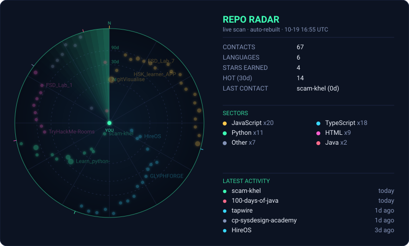

<div align="center">


<a href="https://portfolio-general-ten.vercel.app">Portfolio</a> &nbsp;·&nbsp; <a href="https://www.linkedin.com/in/sodagum-venkata-kaushik-3497a4248/">LinkedIn</a> &nbsp;·&nbsp; <a href="https://x.com/svKaushik2210">X</a> &nbsp;·&nbsp; <a href="https://github.com/Kaushik2210?tab=repositories">Repositories</a>

<br/>


<a href="https://github.com/Kaushik2210?tab=repositories"></a>

<sub>Rebuilt from my avatar on every run. The numbers beside it come straight from the GitHub API.</sub>


<sub>Three live gauges: how consistent I am, when in the day I ship, and how this quarter compares to the last.</sub>


<a href="https://github.com/Kaushik2210#js-contribution-activity"></a>

<sub>One building per day. Height is commits, lit windows mean activity, the red beacon marks my busiest day.</sub>


<a href="https://github.com/Kaushik2210?tab=repositories&sort=updated"></a>

<sub>Every repo is a blip. Closer to the centre means pushed more recently; the sweep makes each one flash.</sub>


<a href="https://github.com/Kaushik2210/issues/new?template=star.yml"></a>

<sub>One star per day for the last year; the core is today.<br/><b><a href="https://github.com/Kaushik2210/issues/new?template=star.yml">Add your own star</a></b>: pick a colour and your handle orbits here too.</sub>


<sub>What I'm shipping right now, newest first. Tap a card to expand it.</sub>

</div>

<br/>

<!--OPS_START-->
<details>
<summary>🐍 <b>scam-khel</b> &nbsp;·&nbsp; <code>Python</code> &nbsp;·&nbsp; ⭐ 0 &nbsp;·&nbsp; pushed today</summary>

> Private family shield against Indian digital-arrest scams: live detection, simulated honeypot, family alerts, complaint drafts. Nebius Token Factory + NVIDIA Nemotron + Tavily.

`fastapi` `fraud-prevention` `hackathon` `honeypot` `india` `llm` &nbsp;·&nbsp; [repo](https://github.com/Kaushik2210/scam-khel) · [commits](https://github.com/Kaushik2210/scam-khel/commits)

</details>

<details>
<summary>☕ <b>100-days-of-java</b> &nbsp;·&nbsp; <code>Java</code> &nbsp;·&nbsp; ⭐ 0 &nbsp;·&nbsp; pushed today</summary>

> Daily Java practice log

[repo](https://github.com/Kaushik2210/100-days-of-java) · [commits](https://github.com/Kaushik2210/100-days-of-java/commits)

</details>

<details>
<summary>📦 <b>cp-sysdesign-academy</b> &nbsp;·&nbsp; <code>MDX</code> &nbsp;·&nbsp; ⭐ 0 &nbsp;·&nbsp; pushed yesterday</summary>

> Open-source interactive course: competitive programming and system design (static site, runs in the browser)

[repo](https://github.com/Kaushik2210/cp-sysdesign-academy) · [commits](https://github.com/Kaushik2210/cp-sysdesign-academy/commits)

</details>

<details>
<summary>🔷 <b>tapwire</b> &nbsp;·&nbsp; <code>TypeScript</code> &nbsp;·&nbsp; ⭐ 0 &nbsp;·&nbsp; pushed yesterday</summary>

> Turns every mistake an AI coding agent makes into a permanent, enforced rule, and measures how often it repeats fixed mistakes.

`ai-agents` `code-quality` `developer-tools` `hackathon` `nextjs` `typescript` &nbsp;·&nbsp; [repo](https://github.com/Kaushik2210/tapwire) · [live](https://tapwire-xi.vercel.app) · [commits](https://github.com/Kaushik2210/tapwire/commits)

</details>

<details>
<summary>🔷 <b>HireOS</b> &nbsp;·&nbsp; <code>TypeScript</code> &nbsp;·&nbsp; ⭐ 0 &nbsp;·&nbsp; pushed 3d ago</summary>

> Job-search workspace that shows its evidence: fit scoring, tailored materials without invention, and application tracking. Prepares, never submits.

`career-tools` `job-search` `nextjs` `productivity` `react` `supabase` &nbsp;·&nbsp; [repo](https://github.com/Kaushik2210/HireOS) · [live](https://hireos-beryl.vercel.app) · [commits](https://github.com/Kaushik2210/HireOS/commits)

</details>

<details>
<summary>🐍 <b>Voice-Agents-</b> &nbsp;·&nbsp; <code>Python</code> &nbsp;·&nbsp; ⭐ 0 &nbsp;·&nbsp; pushed 3d ago</summary>

> No description yet. Still cooking.

[repo](https://github.com/Kaushik2210/Voice-Agents-) · [commits](https://github.com/Kaushik2210/Voice-Agents-/commits)

</details>

<details>
<summary>🔷 <b>Portfolio_General</b> &nbsp;·&nbsp; <code>TypeScript</code> &nbsp;·&nbsp; ⭐ 0 &nbsp;·&nbsp; pushed 3d ago</summary>

> No description yet. Still cooking.

[repo](https://github.com/Kaushik2210/Portfolio_General) · [live](https://portfolio-general-ten.vercel.app) · [commits](https://github.com/Kaushik2210/Portfolio_General/commits)

</details>

<details>
<summary>🐍 <b>Net-Sentinel</b> &nbsp;·&nbsp; <code>Python</code> &nbsp;·&nbsp; ⭐ 0 &nbsp;·&nbsp; pushed 3d ago</summary>

> Explainable network digital twin for threat detection, attack reconstruction and investigation, with MITRE ATT&amp;CK mapping. Consumes Zeek and Suricata telemetry.

`cybersecurity` `fastapi` `mitre-attack` `network-security` `python` `suricata` &nbsp;·&nbsp; [repo](https://github.com/Kaushik2210/Net-Sentinel) · [commits](https://github.com/Kaushik2210/Net-Sentinel/commits)

</details>
<!--OPS_END-->

<br/>

<div align="center">


**A three-stage CTF is hidden in this profile.** Crack it and you join the Hall of Fame below, automatically.

</div>

```text
STAGE 1 / 3   (base64)
U1RBR0UgMS8zIDo6IG5pY2UsIHlvdSBkZWNvZGVkIGJhc2U2NC4gdGhlIHJhZGFyIGlzIG1vcmUgdGhhbiBhIHBpY3R1cmU6IG9wZW4gYXNzZXRzL3JhZGFyLnN2ZyBhcyByYXcgdGV4dCBhbmQgcmVhZCBpdHMgPGRlc2M+IGVsZW1lbnQuIGl0IGlzIGhleC4=
```

<details>
<summary><b>Rules and how to submit</b></summary>

<br/>

- Each stage leads to the next. The final answer is a flag shaped like `KAUSHIK{...}`.
- **Don't post the flag.** Issues are public. Submit a *proof* bound to your login instead:
  ```bash
  echo -n "KAUSHIK{the_flag_you_found}:your-github-login" | sha256sum | cut -c1-12
  ```
  (login in lowercase, 12 hex characters out.) A leaked proof is useless to anyone else.
- [**Submit your proof**](https://github.com/Kaushik2210/issues/new?template=ctf.yml). An Action checks it and, if it's right, adds you below within a minute.
- No brute force needed. Everything you need is in this repo and my other repos' names.

</details>

<div align="center">

**Hall of Fame**

</div>

<!--HOF_START-->
_no one has cracked it yet. first blood is up for grabs._
<!--HOF_END-->

<br/>

<div align="center">


<br/><br/>


<br/><br/>

<sub>Every chart above is generated from my GitHub data by scripts in this repo and rebuilt every six hours.</sub>

</div>
