<div align="center">




[**Portfolio**](https://portfolio-general-ten.vercel.app) · [**LinkedIn**](https://www.linkedin.com/in/sodagum-venkata-kaushik-3497a4248/) · [**X**](https://x.com/svKaushik2210) · [**All repos**](https://github.com/Kaushik2210?tab=repositories)

<sub>🟩 <a href="https://github.com/Kaushik2210/Kaushik2210/issues/new?template=square.yml">light a square</a> &nbsp;·&nbsp; 🔓 <a href="#-intercepted-transmission">crack the CTF</a> &nbsp;·&nbsp; 👋 <a href="https://github.com/Kaushik2210/Kaushik2210/issues/new?template=hello.yml">say hello</a></sub>

</div>

## ▦ Shipped, square by square

Ten projects, each with its own heatmap: one square per day, last 26 weeks. Tap a card for the live demo or the source.

<table>
<tr><td width="50%" valign="top"><a href="https://kaushik2210.github.io/IntentGuard/"><picture><source media="(prefers-color-scheme: dark)" srcset="assets/p-intentguard-dark.svg"><source media="(prefers-color-scheme: light)" srcset="assets/p-intentguard-light.svg"></picture></a><br><sub><a href="https://github.com/Kaushik2210/IntentGuard">source</a> · <a href="https://kaushik2210.github.io/IntentGuard/"><b>live demo</b></a></sub></td><td width="50%" valign="top"><a href="https://github.com/Kaushik2210/Net-Sentinel"><picture><source media="(prefers-color-scheme: dark)" srcset="assets/p-net-sentinel-dark.svg"><source media="(prefers-color-scheme: light)" srcset="assets/p-net-sentinel-light.svg"></picture></a><br><sub><a href="https://github.com/Kaushik2210/Net-Sentinel">source</a></sub></td></tr>
<tr><td width="50%" valign="top"><a href="https://github.com/Kaushik2210/ORBITAL-SENTINEL"><picture><source media="(prefers-color-scheme: dark)" srcset="assets/p-orbital-sentinel-dark.svg"><source media="(prefers-color-scheme: light)" srcset="assets/p-orbital-sentinel-light.svg"></picture></a><br><sub><a href="https://github.com/Kaushik2210/ORBITAL-SENTINEL">source</a></sub></td><td width="50%" valign="top"><a href="https://github.com/Kaushik2210/Deepfake-Detector"><picture><source media="(prefers-color-scheme: dark)" srcset="assets/p-deepfake-detector-dark.svg"><source media="(prefers-color-scheme: light)" srcset="assets/p-deepfake-detector-light.svg"></picture></a><br><sub><a href="https://github.com/Kaushik2210/Deepfake-Detector">source</a></sub></td></tr>
<tr><td width="50%" valign="top"><a href="https://tapwire-xi.vercel.app"><picture><source media="(prefers-color-scheme: dark)" srcset="assets/p-tapwire-dark.svg"><source media="(prefers-color-scheme: light)" srcset="assets/p-tapwire-light.svg"></picture></a><br><sub><a href="https://github.com/Kaushik2210/tapwire">source</a> · <a href="https://tapwire-xi.vercel.app"><b>live demo</b></a></sub></td><td width="50%" valign="top"><a href="https://kaushik2210.github.io/gitVisualise/"><picture><source media="(prefers-color-scheme: dark)" srcset="assets/p-gitvisualise-dark.svg"><source media="(prefers-color-scheme: light)" srcset="assets/p-gitvisualise-light.svg"></picture></a><br><sub><a href="https://github.com/Kaushik2210/gitVisualise">source</a> · <a href="https://kaushik2210.github.io/gitVisualise/"><b>live demo</b></a></sub></td></tr>
<tr><td width="50%" valign="top"><a href="https://hireos-beryl.vercel.app"><picture><source media="(prefers-color-scheme: dark)" srcset="assets/p-hireos-dark.svg"><source media="(prefers-color-scheme: light)" srcset="assets/p-hireos-light.svg"></picture></a><br><sub><a href="https://github.com/Kaushik2210/HireOS">source</a> · <a href="https://hireos-beryl.vercel.app"><b>live demo</b></a></sub></td><td width="50%" valign="top"><a href="https://algoverse-lovat-seven.vercel.app"><picture><source media="(prefers-color-scheme: dark)" srcset="assets/p-algoverse-dark.svg"><source media="(prefers-color-scheme: light)" srcset="assets/p-algoverse-light.svg"></picture></a><br><sub><a href="https://github.com/Kaushik2210/AlgoVerse">source</a> · <a href="https://algoverse-lovat-seven.vercel.app"><b>live demo</b></a></sub></td></tr>
<tr><td width="50%" valign="top"><a href="https://github.com/Kaushik2210/scam-khel"><picture><source media="(prefers-color-scheme: dark)" srcset="assets/p-scam-khel-dark.svg"><source media="(prefers-color-scheme: light)" srcset="assets/p-scam-khel-light.svg"></picture></a><br><sub><a href="https://github.com/Kaushik2210/scam-khel">source</a></sub></td><td width="50%" valign="top"><a href="https://github.com/Kaushik2210/aiforge"><picture><source media="(prefers-color-scheme: dark)" srcset="assets/p-aiforge-dark.svg"><source media="(prefers-color-scheme: light)" srcset="assets/p-aiforge-light.svg"></picture></a><br><sub><a href="https://github.com/Kaushik2210/aiforge">source</a></sub></td></tr>
</table>

## ▦ My year, alive

<picture><source media="(prefers-color-scheme: dark)" srcset="assets/year-dark.svg"><source media="(prefers-color-scheme: light)" srcset="assets/year-light.svg"></picture>

<sub>Frame 0 is my real calendar. Then Conway's Game of Life takes over: survivors get brighter, newborns start dim, crowded squares go dark. Then it loops.</sub>

## ▦ The square wall

<a href="https://github.com/Kaushik2210/Kaushik2210/issues/new?template=square.yml"><picture><source media="(prefers-color-scheme: dark)" srcset="assets/wall-dark.svg"><source media="(prefers-color-scheme: light)" srcset="assets/wall-light.svg"></picture></a>

<div align="center">

**[🟩 Light your square →](https://github.com/Kaushik2210/Kaushik2210/issues/new?template=square.yml)** &nbsp; Open an issue, pick a shade, leave a message. A bot puts your handle on the wall within a minute.

</div>

## ▦ Intercepted transmission


**A three-stage CTF is hidden in this profile.** Crack it and a bot adds you to the Hall of Fame.

```text
STAGE 1 / 3   (base64)
U1RBR0UgMS8zIDo6IG5pY2UsIHlvdSBkZWNvZGVkIGJhc2U2NC4gdGhlIGNpdHkgaXMgbW9yZSB0aGFuIGEgcGljdHVyZTogb3BlbiBhc3NldHMvY2l0eS5zdmcgYXMgcmF3IHRleHQgYW5kIHJlYWQgaXRzIDxkZXNjPiBlbGVtZW50LiBpdCBpcyBoZXgu
```

<details>
<summary><b>Rules and how to submit</b></summary>

<br>

- Each stage leads to the next. The final answer is a flag shaped like `KAUSHIK{...}`.
- **Don't post the flag.** Issues are public. Submit a *proof* bound to your login instead:
  ```bash
  echo -n "KAUSHIK{the_flag_you_found}:your-github-login" | sha256sum | cut -c1-12
  ```
  (login in lowercase, 12 hex characters out.) A leaked proof is useless to anyone else.
- [**Submit your proof**](https://github.com/Kaushik2210/Kaushik2210/issues/new?template=ctf.yml). An Action checks it and, if it's right, adds you below within a minute.
- No brute force needed. Everything you need is in this repo and my other repos' names.

</details>

**Hall of Fame**

<!--HOF_START-->
| # | operator | cracked on |
|:-:|:--|:--|
| 🥇 | [@renuthomas](https://github.com/renuthomas) | 2026-10-29 |
<!--HOF_END-->

## ▦ Built with

<picture><source media="(prefers-color-scheme: dark)" srcset="assets/stack-dark.svg"><source media="(prefers-color-scheme: light)" srcset="assets/stack-light.svg"></picture>

<sub>**Toolbox:** React · Next.js · Node · FastAPI · Supabase · Tailwind · Docker · Zeek & Suricata · MITRE ATT&CK · LLM agents & tool calling · Chrome extensions · GitHub Actions</sub>

## ▦ Work with me

<a href="https://www.linkedin.com/in/sodagum-venkata-kaushik-3497a4248/"><picture><source media="(prefers-color-scheme: dark)" srcset="assets/hire-dark.svg"><source media="(prefers-color-scheme: light)" srcset="assets/hire-light.svg"></picture></a>

<div align="center">

**Have a project?** [Message me on LinkedIn](https://www.linkedin.com/in/sodagum-venkata-kaushik-3497a4248/) · [open a hello issue](https://github.com/Kaushik2210/Kaushik2210/issues/new?template=hello.yml) · [see the portfolio](https://portfolio-general-ten.vercel.app)

<sub>Every square, tower and pixel here is drawn from live GitHub data by <a href="scripts">two Python scripts</a> and redrawn every 6 hours.</sub>

</div>
