<div align="center">


<a href="https://portfolio-general-ten.vercel.app">Portfolio</a> &nbsp;·&nbsp; <a href="https://www.linkedin.com/in/sodagum-venkata-kaushik-3497a4248/">LinkedIn</a> &nbsp;·&nbsp; <a href="https://x.com/svKaushik2210">X</a> &nbsp;·&nbsp; <a href="https://github.com/Kaushik2210?tab=repositories">Repositories</a>

<br/>


<a href="https://github.com/Kaushik2210?tab=repositories"></a>

<sub>Rebuilt from my avatar on every run. The numbers beside it come straight from the GitHub API.</sub>


<sub>Three live gauges: how consistent I am, when in the day I ship, and how this quarter compares to the last.</sub>


<a href="https://github.com/Kaushik2210#js-contribution-activity"></a>

<sub>One building per day. Height is commits, lit windows mean activity, the red beacon marks my busiest day.</sub>


<a href="https://github.com/Kaushik2210?tab=repositories&sort=updated"></a>

<sub>Every repo is a neuron, wired to the ones it shares topics, a name family or a language with. Rings mark what I pushed this week.</sub>

</div>

<div align="center">


<a href="https://github.com/Kaushik2210/Kaushik2210/issues/new?template=star.yml"></a>

<sub>One star per day for the last year; the core is today.<br/><b><a href="https://github.com/Kaushik2210/Kaushik2210/issues/new?template=star.yml">Add your own star</a></b>: pick a colour and your handle orbits here too.</sub>


<sub>My last two weeks of pushes, one lane per repo. Taller bar, busier window. The table below has the details.</sub>

</div>

<!--OPS_START-->
| Repo | Stack | Last push | Brief |
|:--|:--|:--|:--|
| [**100-days-of-java**](https://github.com/Kaushik2210/100-days-of-java) | `Java` | yesterday | Daily Java practice log |
| [**scam-khel**](https://github.com/Kaushik2210/scam-khel) | `Python` | 4d ago | Private family shield against Indian digital-arrest scams: live detection, simulated honeypot… |
| [**cp-sysdesign-academy**](https://github.com/Kaushik2210/cp-sysdesign-academy) | `MDX` | 5d ago | Open-source interactive course: competitive programming and system design (static site, runs in… |
| [**Hivora**](https://github.com/Kaushik2210/Hivora) | `misc` | 5d ago | _Still cooking._ |
| [**tapwire**](https://github.com/Kaushik2210/tapwire) · [live](https://tapwire-xi.vercel.app) | `TypeScript` | 5d ago | Turns every mistake an AI coding agent makes into a permanent, enforced rule, and measures how… |
| [**HireOS**](https://github.com/Kaushik2210/HireOS) · [live](https://hireos-beryl.vercel.app) | `TypeScript` | 7d ago | Job-search workspace that shows its evidence: fit scoring, tailored materials without… |
| [**Voice-Agents-**](https://github.com/Kaushik2210/Voice-Agents-) | `Python` | 8d ago | _Still cooking._ |
| [**Portfolio_General**](https://github.com/Kaushik2210/Portfolio_General) · [live](https://portfolio-general-ten.vercel.app) | `TypeScript` | 8d ago | _Still cooking._ |
<!--OPS_END-->

<br/>

<div align="center">


**A three-stage CTF is hidden in this profile.** Crack it and you join the Hall of Fame below, automatically.

</div>

```text
STAGE 1 / 3   (base64)
U1RBR0UgMS8zIDo6IG5pY2UsIHlvdSBkZWNvZGVkIGJhc2U2NC4gdGhlIHJlcG8gbWFwIGlzIG1vcmUgdGhhbiBhIHBpY3R1cmU6IG9wZW4gYXNzZXRzL25ldXJhbC5zdmcgYXMgcmF3IHRleHQgYW5kIHJlYWQgaXRzIDxkZXNjPiBlbGVtZW50LiBpdCBpcyBoZXgu
```

<details>
<summary><b>Rules and how to submit</b></summary>

<br/>

- Each stage leads to the next. The final answer is a flag shaped like `KAUSHIK{...}`.
- **Don't post the flag.** Issues are public. Submit a *proof* bound to your login instead:
  ```bash
  echo -n "KAUSHIK{the_flag_you_found}:your-github-login" | sha256sum | cut -c1-12
  ```
  (login in lowercase, 12 hex characters out.) A leaked proof is useless to anyone else.
- [**Submit your proof**](https://github.com/Kaushik2210/Kaushik2210/issues/new?template=ctf.yml). An Action checks it and, if it's right, adds you below within a minute.
- No brute force needed. Everything you need is in this repo and my other repos' names.

</details>

<div align="center">

**Hall of Fame**

</div>

<!--HOF_START-->
_no one has cracked it yet. first blood is up for grabs._
<!--HOF_END-->

<br/>

<div align="center">


<br/><br/>


<br/><br/>

<sub>Every chart above is generated from my GitHub data by scripts in this repo and rebuilt every six hours.</sub>

</div>
