<div align="center">


<a href="#whoami"><kbd> whoami </kbd></a> <a href="#shipped"><kbd> shipped </kbd></a> <a href="#bugsweeper"><kbd> 🐛 play bugsweeper </kbd></a> <a href="#alive"><kbd> alive </kbd></a> <a href="#the-wall"><kbd> 🟩 the wall </kbd></a> <a href="#ctf"><kbd> 🔓 ctf </kbd></a> <a href="#hire-me"><kbd> hire me </kbd></a>

</div>

<a name="whoami"></a>

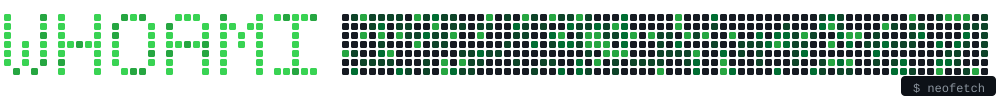


<div align="center">

[**Portfolio**](https://portfolio-general-ten.vercel.app) · [**LinkedIn**](https://www.linkedin.com/in/sodagum-venkata-kaushik-3497a4248/) · [**X**](https://x.com/svKaushik2210) · [**All repos**](https://github.com/Kaushik2210?tab=repositories)

</div>

<a name="shipped"></a>

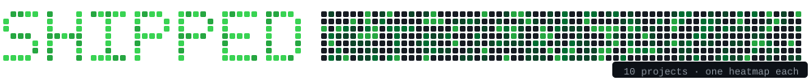

Each card carries its own heatmap: one square per day, last 26 weeks. Tap a card for the live demo or the source.

<table>
<tr><td width="50%" valign="top"><a href="https://kaushik2210.github.io/IntentGuard/"><picture><source media="(prefers-color-scheme: dark)" srcset="assets/p-intentguard-dark.svg"><source media="(prefers-color-scheme: light)" srcset="assets/p-intentguard-light.svg"></picture></a><br><sub><a href="https://github.com/Kaushik2210/IntentGuard">source</a> · <a href="https://kaushik2210.github.io/IntentGuard/"><b>live demo</b></a></sub></td><td width="50%" valign="top"><a href="https://github.com/Kaushik2210/Net-Sentinel"><picture><source media="(prefers-color-scheme: dark)" srcset="assets/p-net-sentinel-dark.svg"><source media="(prefers-color-scheme: light)" srcset="assets/p-net-sentinel-light.svg"></picture></a><br><sub><a href="https://github.com/Kaushik2210/Net-Sentinel">source</a></sub></td></tr>
<tr><td width="50%" valign="top"><a href="https://github.com/Kaushik2210/ORBITAL-SENTINEL"><picture><source media="(prefers-color-scheme: dark)" srcset="assets/p-orbital-sentinel-dark.svg"><source media="(prefers-color-scheme: light)" srcset="assets/p-orbital-sentinel-light.svg"></picture></a><br><sub><a href="https://github.com/Kaushik2210/ORBITAL-SENTINEL">source</a></sub></td><td width="50%" valign="top"><a href="https://github.com/Kaushik2210/Deepfake-Detector"><picture><source media="(prefers-color-scheme: dark)" srcset="assets/p-deepfake-detector-dark.svg"><source media="(prefers-color-scheme: light)" srcset="assets/p-deepfake-detector-light.svg"></picture></a><br><sub><a href="https://github.com/Kaushik2210/Deepfake-Detector">source</a></sub></td></tr>
<tr><td width="50%" valign="top"><a href="https://tapwire-xi.vercel.app"><picture><source media="(prefers-color-scheme: dark)" srcset="assets/p-tapwire-dark.svg"><source media="(prefers-color-scheme: light)" srcset="assets/p-tapwire-light.svg"></picture></a><br><sub><a href="https://github.com/Kaushik2210/tapwire">source</a> · <a href="https://tapwire-xi.vercel.app"><b>live demo</b></a></sub></td><td width="50%" valign="top"><a href="https://kaushik2210.github.io/gitVisualise/"><picture><source media="(prefers-color-scheme: dark)" srcset="assets/p-gitvisualise-dark.svg"><source media="(prefers-color-scheme: light)" srcset="assets/p-gitvisualise-light.svg"></picture></a><br><sub><a href="https://github.com/Kaushik2210/gitVisualise">source</a> · <a href="https://kaushik2210.github.io/gitVisualise/"><b>live demo</b></a></sub></td></tr>
<tr><td width="50%" valign="top"><a href="https://hireos-beryl.vercel.app"><picture><source media="(prefers-color-scheme: dark)" srcset="assets/p-hireos-dark.svg"><source media="(prefers-color-scheme: light)" srcset="assets/p-hireos-light.svg"></picture></a><br><sub><a href="https://github.com/Kaushik2210/HireOS">source</a> · <a href="https://hireos-beryl.vercel.app"><b>live demo</b></a></sub></td><td width="50%" valign="top"><a href="https://algoverse-lovat-seven.vercel.app"><picture><source media="(prefers-color-scheme: dark)" srcset="assets/p-algoverse-dark.svg"><source media="(prefers-color-scheme: light)" srcset="assets/p-algoverse-light.svg"></picture></a><br><sub><a href="https://github.com/Kaushik2210/AlgoVerse">source</a> · <a href="https://algoverse-lovat-seven.vercel.app"><b>live demo</b></a></sub></td></tr>
<tr><td width="50%" valign="top"><a href="https://github.com/Kaushik2210/scam-khel"><picture><source media="(prefers-color-scheme: dark)" srcset="assets/p-scam-khel-dark.svg"><source media="(prefers-color-scheme: light)" srcset="assets/p-scam-khel-light.svg"></picture></a><br><sub><a href="https://github.com/Kaushik2210/scam-khel">source</a></sub></td><td width="50%" valign="top"><a href="https://github.com/Kaushik2210/aiforge"><picture><source media="(prefers-color-scheme: dark)" srcset="assets/p-aiforge-dark.svg"><source media="(prefers-color-scheme: light)" srcset="assets/p-aiforge-light.svg"></picture></a><br><sub><a href="https://github.com/Kaushik2210/aiforge">source</a></sub></td></tr>
</table>

<a name="bugsweeper"></a>

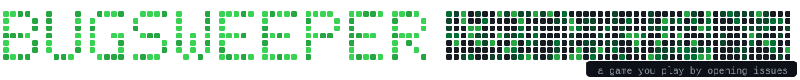

**A Minesweeper the whole internet plays together, right here.** 20 bugs hide under this board. Click a square, press *Create* on the issue that opens, and a bot makes your move within a minute.

<!--SWEEP_START-->
<div align="center">

**Game 1** · 20 bugs hidden · **58** safe squares left · 1 moves so far

<p align="center"><a href="https://github.com/Kaushik2210/Kaushik2210/issues/new?title=%5BSWEEP%5D%20A1&body=Just%20press%20%2A%2ACreate%2A%2A%20%28or%20Submit%20new%20issue%29.%20A%20bot%20makes%20your%20move%20and%20replies%20here%20within%20a%20minute."></a><a href="https://github.com/Kaushik2210/Kaushik2210/issues/new?title=%5BSWEEP%5D%20B1&body=Just%20press%20%2A%2ACreate%2A%2A%20%28or%20Submit%20new%20issue%29.%20A%20bot%20makes%20your%20move%20and%20replies%20here%20within%20a%20minute."></a><a href="https://github.com/Kaushik2210/Kaushik2210/issues/new?title=%5BSWEEP%5D%20C1&body=Just%20press%20%2A%2ACreate%2A%2A%20%28or%20Submit%20new%20issue%29.%20A%20bot%20makes%20your%20move%20and%20replies%20here%20within%20a%20minute."></a><a href="https://github.com/Kaushik2210/Kaushik2210/issues/new?title=%5BSWEEP%5D%20D1&body=Just%20press%20%2A%2ACreate%2A%2A%20%28or%20Submit%20new%20issue%29.%20A%20bot%20makes%20your%20move%20and%20replies%20here%20within%20a%20minute."></a><a href="https://github.com/Kaushik2210/Kaushik2210/issues/new?title=%5BSWEEP%5D%20E1&body=Just%20press%20%2A%2ACreate%2A%2A%20%28or%20Submit%20new%20issue%29.%20A%20bot%20makes%20your%20move%20and%20replies%20here%20within%20a%20minute."></a><a href="https://github.com/Kaushik2210/Kaushik2210/issues/new?title=%5BSWEEP%5D%20F1&body=Just%20press%20%2A%2ACreate%2A%2A%20%28or%20Submit%20new%20issue%29.%20A%20bot%20makes%20your%20move%20and%20replies%20here%20within%20a%20minute."></a><a href="https://github.com/Kaushik2210/Kaushik2210/issues/new?title=%5BSWEEP%5D%20G1&body=Just%20press%20%2A%2ACreate%2A%2A%20%28or%20Submit%20new%20issue%29.%20A%20bot%20makes%20your%20move%20and%20replies%20here%20within%20a%20minute."></a><a href="https://github.com/Kaushik2210/Kaushik2210/issues/new?title=%5BSWEEP%5D%20H1&body=Just%20press%20%2A%2ACreate%2A%2A%20%28or%20Submit%20new%20issue%29.%20A%20bot%20makes%20your%20move%20and%20replies%20here%20within%20a%20minute."></a><a href="https://github.com/Kaushik2210/Kaushik2210/issues/new?title=%5BSWEEP%5D%20I1&body=Just%20press%20%2A%2ACreate%2A%2A%20%28or%20Submit%20new%20issue%29.%20A%20bot%20makes%20your%20move%20and%20replies%20here%20within%20a%20minute."></a><a href="https://github.com/Kaushik2210/Kaushik2210/issues/new?title=%5BSWEEP%5D%20J1&body=Just%20press%20%2A%2ACreate%2A%2A%20%28or%20Submit%20new%20issue%29.%20A%20bot%20makes%20your%20move%20and%20replies%20here%20within%20a%20minute."></a><a href="https://github.com/Kaushik2210/Kaushik2210/issues/new?title=%5BSWEEP%5D%20K1&body=Just%20press%20%2A%2ACreate%2A%2A%20%28or%20Submit%20new%20issue%29.%20A%20bot%20makes%20your%20move%20and%20replies%20here%20within%20a%20minute."></a><a href="https://github.com/Kaushik2210/Kaushik2210/issues/new?title=%5BSWEEP%5D%20L1&body=Just%20press%20%2A%2ACreate%2A%2A%20%28or%20Submit%20new%20issue%29.%20A%20bot%20makes%20your%20move%20and%20replies%20here%20within%20a%20minute."></a><a href="https://github.com/Kaushik2210/Kaushik2210/issues/new?title=%5BSWEEP%5D%20M1&body=Just%20press%20%2A%2ACreate%2A%2A%20%28or%20Submit%20new%20issue%29.%20A%20bot%20makes%20your%20move%20and%20replies%20here%20within%20a%20minute."></a><a href="https://github.com/Kaushik2210/Kaushik2210/issues/new?title=%5BSWEEP%5D%20N1&body=Just%20press%20%2A%2ACreate%2A%2A%20%28or%20Submit%20new%20issue%29.%20A%20bot%20makes%20your%20move%20and%20replies%20here%20within%20a%20minute."></a><a href="https://github.com/Kaushik2210/Kaushik2210/issues/new?title=%5BSWEEP%5D%20O1&body=Just%20press%20%2A%2ACreate%2A%2A%20%28or%20Submit%20new%20issue%29.%20A%20bot%20makes%20your%20move%20and%20replies%20here%20within%20a%20minute."></a><a href="https://github.com/Kaushik2210/Kaushik2210/issues/new?title=%5BSWEEP%5D%20P1&body=Just%20press%20%2A%2ACreate%2A%2A%20%28or%20Submit%20new%20issue%29.%20A%20bot%20makes%20your%20move%20and%20replies%20here%20within%20a%20minute."></a><br><a href="https://github.com/Kaushik2210/Kaushik2210/issues/new?title=%5BSWEEP%5D%20A2&body=Just%20press%20%2A%2ACreate%2A%2A%20%28or%20Submit%20new%20issue%29.%20A%20bot%20makes%20your%20move%20and%20replies%20here%20within%20a%20minute."></a><a href="https://github.com/Kaushik2210/Kaushik2210/issues/new?title=%5BSWEEP%5D%20B2&body=Just%20press%20%2A%2ACreate%2A%2A%20%28or%20Submit%20new%20issue%29.%20A%20bot%20makes%20your%20move%20and%20replies%20here%20within%20a%20minute."></a><a href="https://github.com/Kaushik2210/Kaushik2210/issues/new?title=%5BSWEEP%5D%20C2&body=Just%20press%20%2A%2ACreate%2A%2A%20%28or%20Submit%20new%20issue%29.%20A%20bot%20makes%20your%20move%20and%20replies%20here%20within%20a%20minute."></a><a href="https://github.com/Kaushik2210/Kaushik2210/issues/new?title=%5BSWEEP%5D%20D2&body=Just%20press%20%2A%2ACreate%2A%2A%20%28or%20Submit%20new%20issue%29.%20A%20bot%20makes%20your%20move%20and%20replies%20here%20within%20a%20minute."></a><a href="https://github.com/Kaushik2210/Kaushik2210/issues/new?title=%5BSWEEP%5D%20E2&body=Just%20press%20%2A%2ACreate%2A%2A%20%28or%20Submit%20new%20issue%29.%20A%20bot%20makes%20your%20move%20and%20replies%20here%20within%20a%20minute."></a><a href="https://github.com/Kaushik2210/Kaushik2210/issues/new?title=%5BSWEEP%5D%20F2&body=Just%20press%20%2A%2ACreate%2A%2A%20%28or%20Submit%20new%20issue%29.%20A%20bot%20makes%20your%20move%20and%20replies%20here%20within%20a%20minute."></a><a href="https://github.com/Kaushik2210/Kaushik2210/issues/new?title=%5BSWEEP%5D%20G2&body=Just%20press%20%2A%2ACreate%2A%2A%20%28or%20Submit%20new%20issue%29.%20A%20bot%20makes%20your%20move%20and%20replies%20here%20within%20a%20minute."></a><a href="https://github.com/Kaushik2210/Kaushik2210/issues/new?title=%5BSWEEP%5D%20H2&body=Just%20press%20%2A%2ACreate%2A%2A%20%28or%20Submit%20new%20issue%29.%20A%20bot%20makes%20your%20move%20and%20replies%20here%20within%20a%20minute."></a><a href="https://github.com/Kaushik2210/Kaushik2210/issues/new?title=%5BSWEEP%5D%20I2&body=Just%20press%20%2A%2ACreate%2A%2A%20%28or%20Submit%20new%20issue%29.%20A%20bot%20makes%20your%20move%20and%20replies%20here%20within%20a%20minute."></a><a href="https://github.com/Kaushik2210/Kaushik2210/issues/new?title=%5BSWEEP%5D%20J2&body=Just%20press%20%2A%2ACreate%2A%2A%20%28or%20Submit%20new%20issue%29.%20A%20bot%20makes%20your%20move%20and%20replies%20here%20within%20a%20minute."></a><a href="https://github.com/Kaushik2210/Kaushik2210/issues/new?title=%5BSWEEP%5D%20K2&body=Just%20press%20%2A%2ACreate%2A%2A%20%28or%20Submit%20new%20issue%29.%20A%20bot%20makes%20your%20move%20and%20replies%20here%20within%20a%20minute."></a><a href="https://github.com/Kaushik2210/Kaushik2210/issues/new?title=%5BSWEEP%5D%20L2&body=Just%20press%20%2A%2ACreate%2A%2A%20%28or%20Submit%20new%20issue%29.%20A%20bot%20makes%20your%20move%20and%20replies%20here%20within%20a%20minute."></a><a href="https://github.com/Kaushik2210/Kaushik2210/issues/new?title=%5BSWEEP%5D%20M2&body=Just%20press%20%2A%2ACreate%2A%2A%20%28or%20Submit%20new%20issue%29.%20A%20bot%20makes%20your%20move%20and%20replies%20here%20within%20a%20minute."></a><a href="https://github.com/Kaushik2210/Kaushik2210/issues/new?title=%5BSWEEP%5D%20N2&body=Just%20press%20%2A%2ACreate%2A%2A%20%28or%20Submit%20new%20issue%29.%20A%20bot%20makes%20your%20move%20and%20replies%20here%20within%20a%20minute."></a><a href="https://github.com/Kaushik2210/Kaushik2210/issues/new?title=%5BSWEEP%5D%20O2&body=Just%20press%20%2A%2ACreate%2A%2A%20%28or%20Submit%20new%20issue%29.%20A%20bot%20makes%20your%20move%20and%20replies%20here%20within%20a%20minute."></a><a href="https://github.com/Kaushik2210/Kaushik2210/issues/new?title=%5BSWEEP%5D%20P2&body=Just%20press%20%2A%2ACreate%2A%2A%20%28or%20Submit%20new%20issue%29.%20A%20bot%20makes%20your%20move%20and%20replies%20here%20within%20a%20minute."></a><br><a href="https://github.com/Kaushik2210/Kaushik2210/issues/new?title=%5BSWEEP%5D%20A3&body=Just%20press%20%2A%2ACreate%2A%2A%20%28or%20Submit%20new%20issue%29.%20A%20bot%20makes%20your%20move%20and%20replies%20here%20within%20a%20minute."></a><a href="https://github.com/Kaushik2210/Kaushik2210/issues/new?title=%5BSWEEP%5D%20B3&body=Just%20press%20%2A%2ACreate%2A%2A%20%28or%20Submit%20new%20issue%29.%20A%20bot%20makes%20your%20move%20and%20replies%20here%20within%20a%20minute."></a><a href="https://github.com/Kaushik2210/Kaushik2210/issues/new?title=%5BSWEEP%5D%20C3&body=Just%20press%20%2A%2ACreate%2A%2A%20%28or%20Submit%20new%20issue%29.%20A%20bot%20makes%20your%20move%20and%20replies%20here%20within%20a%20minute."></a><a href="https://github.com/Kaushik2210/Kaushik2210/issues/new?title=%5BSWEEP%5D%20D3&body=Just%20press%20%2A%2ACreate%2A%2A%20%28or%20Submit%20new%20issue%29.%20A%20bot%20makes%20your%20move%20and%20replies%20here%20within%20a%20minute."></a><a href="https://github.com/Kaushik2210/Kaushik2210/issues/new?title=%5BSWEEP%5D%20E3&body=Just%20press%20%2A%2ACreate%2A%2A%20%28or%20Submit%20new%20issue%29.%20A%20bot%20makes%20your%20move%20and%20replies%20here%20within%20a%20minute."></a><a href="https://github.com/Kaushik2210/Kaushik2210/issues/new?title=%5BSWEEP%5D%20F3&body=Just%20press%20%2A%2ACreate%2A%2A%20%28or%20Submit%20new%20issue%29.%20A%20bot%20makes%20your%20move%20and%20replies%20here%20within%20a%20minute."></a><a href="https://github.com/Kaushik2210/Kaushik2210/issues/new?title=%5BSWEEP%5D%20G3&body=Just%20press%20%2A%2ACreate%2A%2A%20%28or%20Submit%20new%20issue%29.%20A%20bot%20makes%20your%20move%20and%20replies%20here%20within%20a%20minute."></a><a href="https://github.com/Kaushik2210/Kaushik2210/issues/new?title=%5BSWEEP%5D%20H3&body=Just%20press%20%2A%2ACreate%2A%2A%20%28or%20Submit%20new%20issue%29.%20A%20bot%20makes%20your%20move%20and%20replies%20here%20within%20a%20minute."></a><a href="https://github.com/Kaushik2210/Kaushik2210/issues/new?title=%5BSWEEP%5D%20I3&body=Just%20press%20%2A%2ACreate%2A%2A%20%28or%20Submit%20new%20issue%29.%20A%20bot%20makes%20your%20move%20and%20replies%20here%20within%20a%20minute."></a><a href="https://github.com/Kaushik2210/Kaushik2210/issues/new?title=%5BSWEEP%5D%20J3&body=Just%20press%20%2A%2ACreate%2A%2A%20%28or%20Submit%20new%20issue%29.%20A%20bot%20makes%20your%20move%20and%20replies%20here%20within%20a%20minute."></a><a href="https://github.com/Kaushik2210/Kaushik2210/issues/new?title=%5BSWEEP%5D%20K3&body=Just%20press%20%2A%2ACreate%2A%2A%20%28or%20Submit%20new%20issue%29.%20A%20bot%20makes%20your%20move%20and%20replies%20here%20within%20a%20minute."></a><a href="https://github.com/Kaushik2210/Kaushik2210/issues/new?title=%5BSWEEP%5D%20L3&body=Just%20press%20%2A%2ACreate%2A%2A%20%28or%20Submit%20new%20issue%29.%20A%20bot%20makes%20your%20move%20and%20replies%20here%20within%20a%20minute."></a><a href="https://github.com/Kaushik2210/Kaushik2210/issues/new?title=%5BSWEEP%5D%20M3&body=Just%20press%20%2A%2ACreate%2A%2A%20%28or%20Submit%20new%20issue%29.%20A%20bot%20makes%20your%20move%20and%20replies%20here%20within%20a%20minute."></a><a href="https://github.com/Kaushik2210/Kaushik2210/issues/new?title=%5BSWEEP%5D%20N3&body=Just%20press%20%2A%2ACreate%2A%2A%20%28or%20Submit%20new%20issue%29.%20A%20bot%20makes%20your%20move%20and%20replies%20here%20within%20a%20minute."></a><a href="https://github.com/Kaushik2210/Kaushik2210/issues/new?title=%5BSWEEP%5D%20O3&body=Just%20press%20%2A%2ACreate%2A%2A%20%28or%20Submit%20new%20issue%29.%20A%20bot%20makes%20your%20move%20and%20replies%20here%20within%20a%20minute."></a><a href="https://github.com/Kaushik2210/Kaushik2210/issues/new?title=%5BSWEEP%5D%20P3&body=Just%20press%20%2A%2ACreate%2A%2A%20%28or%20Submit%20new%20issue%29.%20A%20bot%20makes%20your%20move%20and%20replies%20here%20within%20a%20minute."></a><br><a href="https://github.com/Kaushik2210/Kaushik2210/issues/new?title=%5BSWEEP%5D%20A4&body=Just%20press%20%2A%2ACreate%2A%2A%20%28or%20Submit%20new%20issue%29.%20A%20bot%20makes%20your%20move%20and%20replies%20here%20within%20a%20minute."></a><a href="https://github.com/Kaushik2210/Kaushik2210/issues/new?title=%5BSWEEP%5D%20B4&body=Just%20press%20%2A%2ACreate%2A%2A%20%28or%20Submit%20new%20issue%29.%20A%20bot%20makes%20your%20move%20and%20replies%20here%20within%20a%20minute."></a><a href="https://github.com/Kaushik2210/Kaushik2210/issues/new?title=%5BSWEEP%5D%20C4&body=Just%20press%20%2A%2ACreate%2A%2A%20%28or%20Submit%20new%20issue%29.%20A%20bot%20makes%20your%20move%20and%20replies%20here%20within%20a%20minute."></a><a href="https://github.com/Kaushik2210/Kaushik2210/issues/new?title=%5BSWEEP%5D%20D4&body=Just%20press%20%2A%2ACreate%2A%2A%20%28or%20Submit%20new%20issue%29.%20A%20bot%20makes%20your%20move%20and%20replies%20here%20within%20a%20minute."></a><a href="https://github.com/Kaushik2210/Kaushik2210/issues/new?title=%5BSWEEP%5D%20E4&body=Just%20press%20%2A%2ACreate%2A%2A%20%28or%20Submit%20new%20issue%29.%20A%20bot%20makes%20your%20move%20and%20replies%20here%20within%20a%20minute."></a><a href="https://github.com/Kaushik2210/Kaushik2210/issues/new?title=%5BSWEEP%5D%20F4&body=Just%20press%20%2A%2ACreate%2A%2A%20%28or%20Submit%20new%20issue%29.%20A%20bot%20makes%20your%20move%20and%20replies%20here%20within%20a%20minute."></a><a href="https://github.com/Kaushik2210/Kaushik2210/issues/new?title=%5BSWEEP%5D%20G4&body=Just%20press%20%2A%2ACreate%2A%2A%20%28or%20Submit%20new%20issue%29.%20A%20bot%20makes%20your%20move%20and%20replies%20here%20within%20a%20minute."></a><a href="https://github.com/Kaushik2210/Kaushik2210/issues/new?title=%5BSWEEP%5D%20H4&body=Just%20press%20%2A%2ACreate%2A%2A%20%28or%20Submit%20new%20issue%29.%20A%20bot%20makes%20your%20move%20and%20replies%20here%20within%20a%20minute."></a><a href="https://github.com/Kaushik2210/Kaushik2210/issues/new?title=%5BSWEEP%5D%20I4&body=Just%20press%20%2A%2ACreate%2A%2A%20%28or%20Submit%20new%20issue%29.%20A%20bot%20makes%20your%20move%20and%20replies%20here%20within%20a%20minute."></a><a href="https://github.com/Kaushik2210/Kaushik2210/issues/new?title=%5BSWEEP%5D%20J4&body=Just%20press%20%2A%2ACreate%2A%2A%20%28or%20Submit%20new%20issue%29.%20A%20bot%20makes%20your%20move%20and%20replies%20here%20within%20a%20minute."></a><a href="https://github.com/Kaushik2210/Kaushik2210/issues/new?title=%5BSWEEP%5D%20K4&body=Just%20press%20%2A%2ACreate%2A%2A%20%28or%20Submit%20new%20issue%29.%20A%20bot%20makes%20your%20move%20and%20replies%20here%20within%20a%20minute."></a><a href="https://github.com/Kaushik2210/Kaushik2210/issues/new?title=%5BSWEEP%5D%20L4&body=Just%20press%20%2A%2ACreate%2A%2A%20%28or%20Submit%20new%20issue%29.%20A%20bot%20makes%20your%20move%20and%20replies%20here%20within%20a%20minute."></a><a href="https://github.com/Kaushik2210/Kaushik2210/issues/new?title=%5BSWEEP%5D%20M4&body=Just%20press%20%2A%2ACreate%2A%2A%20%28or%20Submit%20new%20issue%29.%20A%20bot%20makes%20your%20move%20and%20replies%20here%20within%20a%20minute."></a><a href="https://github.com/Kaushik2210/Kaushik2210/issues/new?title=%5BSWEEP%5D%20N4&body=Just%20press%20%2A%2ACreate%2A%2A%20%28or%20Submit%20new%20issue%29.%20A%20bot%20makes%20your%20move%20and%20replies%20here%20within%20a%20minute."></a><a href="https://github.com/Kaushik2210/Kaushik2210/issues/new?title=%5BSWEEP%5D%20O4&body=Just%20press%20%2A%2ACreate%2A%2A%20%28or%20Submit%20new%20issue%29.%20A%20bot%20makes%20your%20move%20and%20replies%20here%20within%20a%20minute."></a><a href="https://github.com/Kaushik2210/Kaushik2210/issues/new?title=%5BSWEEP%5D%20P4&body=Just%20press%20%2A%2ACreate%2A%2A%20%28or%20Submit%20new%20issue%29.%20A%20bot%20makes%20your%20move%20and%20replies%20here%20within%20a%20minute."></a><br><a href="https://github.com/Kaushik2210/Kaushik2210/issues/new?title=%5BSWEEP%5D%20A5&body=Just%20press%20%2A%2ACreate%2A%2A%20%28or%20Submit%20new%20issue%29.%20A%20bot%20makes%20your%20move%20and%20replies%20here%20within%20a%20minute."></a><a href="https://github.com/Kaushik2210/Kaushik2210/issues/new?title=%5BSWEEP%5D%20B5&body=Just%20press%20%2A%2ACreate%2A%2A%20%28or%20Submit%20new%20issue%29.%20A%20bot%20makes%20your%20move%20and%20replies%20here%20within%20a%20minute."></a><a href="https://github.com/Kaushik2210/Kaushik2210/issues/new?title=%5BSWEEP%5D%20C5&body=Just%20press%20%2A%2ACreate%2A%2A%20%28or%20Submit%20new%20issue%29.%20A%20bot%20makes%20your%20move%20and%20replies%20here%20within%20a%20minute."></a><a href="https://github.com/Kaushik2210/Kaushik2210/issues/new?title=%5BSWEEP%5D%20D5&body=Just%20press%20%2A%2ACreate%2A%2A%20%28or%20Submit%20new%20issue%29.%20A%20bot%20makes%20your%20move%20and%20replies%20here%20within%20a%20minute."></a><a href="https://github.com/Kaushik2210/Kaushik2210/issues/new?title=%5BSWEEP%5D%20E5&body=Just%20press%20%2A%2ACreate%2A%2A%20%28or%20Submit%20new%20issue%29.%20A%20bot%20makes%20your%20move%20and%20replies%20here%20within%20a%20minute."></a><a href="https://github.com/Kaushik2210/Kaushik2210/issues/new?title=%5BSWEEP%5D%20F5&body=Just%20press%20%2A%2ACreate%2A%2A%20%28or%20Submit%20new%20issue%29.%20A%20bot%20makes%20your%20move%20and%20replies%20here%20within%20a%20minute."></a><a href="https://github.com/Kaushik2210/Kaushik2210/issues/new?title=%5BSWEEP%5D%20G5&body=Just%20press%20%2A%2ACreate%2A%2A%20%28or%20Submit%20new%20issue%29.%20A%20bot%20makes%20your%20move%20and%20replies%20here%20within%20a%20minute."></a><a href="https://github.com/Kaushik2210/Kaushik2210/issues/new?title=%5BSWEEP%5D%20H5&body=Just%20press%20%2A%2ACreate%2A%2A%20%28or%20Submit%20new%20issue%29.%20A%20bot%20makes%20your%20move%20and%20replies%20here%20within%20a%20minute."></a><a href="https://github.com/Kaushik2210/Kaushik2210/issues/new?title=%5BSWEEP%5D%20I5&body=Just%20press%20%2A%2ACreate%2A%2A%20%28or%20Submit%20new%20issue%29.%20A%20bot%20makes%20your%20move%20and%20replies%20here%20within%20a%20minute."></a><a href="https://github.com/Kaushik2210/Kaushik2210/issues/new?title=%5BSWEEP%5D%20J5&body=Just%20press%20%2A%2ACreate%2A%2A%20%28or%20Submit%20new%20issue%29.%20A%20bot%20makes%20your%20move%20and%20replies%20here%20within%20a%20minute."></a><a href="https://github.com/Kaushik2210/Kaushik2210/issues/new?title=%5BSWEEP%5D%20K5&body=Just%20press%20%2A%2ACreate%2A%2A%20%28or%20Submit%20new%20issue%29.%20A%20bot%20makes%20your%20move%20and%20replies%20here%20within%20a%20minute."></a><a href="https://github.com/Kaushik2210/Kaushik2210/issues/new?title=%5BSWEEP%5D%20L5&body=Just%20press%20%2A%2ACreate%2A%2A%20%28or%20Submit%20new%20issue%29.%20A%20bot%20makes%20your%20move%20and%20replies%20here%20within%20a%20minute."></a><a href="https://github.com/Kaushik2210/Kaushik2210/issues/new?title=%5BSWEEP%5D%20M5&body=Just%20press%20%2A%2ACreate%2A%2A%20%28or%20Submit%20new%20issue%29.%20A%20bot%20makes%20your%20move%20and%20replies%20here%20within%20a%20minute."></a><a href="https://github.com/Kaushik2210/Kaushik2210/issues/new?title=%5BSWEEP%5D%20N5&body=Just%20press%20%2A%2ACreate%2A%2A%20%28or%20Submit%20new%20issue%29.%20A%20bot%20makes%20your%20move%20and%20replies%20here%20within%20a%20minute."></a><a href="https://github.com/Kaushik2210/Kaushik2210/issues/new?title=%5BSWEEP%5D%20O5&body=Just%20press%20%2A%2ACreate%2A%2A%20%28or%20Submit%20new%20issue%29.%20A%20bot%20makes%20your%20move%20and%20replies%20here%20within%20a%20minute."></a><a href="https://github.com/Kaushik2210/Kaushik2210/issues/new?title=%5BSWEEP%5D%20P5&body=Just%20press%20%2A%2ACreate%2A%2A%20%28or%20Submit%20new%20issue%29.%20A%20bot%20makes%20your%20move%20and%20replies%20here%20within%20a%20minute."></a><br><a href="https://github.com/Kaushik2210/Kaushik2210/issues/new?title=%5BSWEEP%5D%20A6&body=Just%20press%20%2A%2ACreate%2A%2A%20%28or%20Submit%20new%20issue%29.%20A%20bot%20makes%20your%20move%20and%20replies%20here%20within%20a%20minute."></a><a href="https://github.com/Kaushik2210/Kaushik2210/issues/new?title=%5BSWEEP%5D%20B6&body=Just%20press%20%2A%2ACreate%2A%2A%20%28or%20Submit%20new%20issue%29.%20A%20bot%20makes%20your%20move%20and%20replies%20here%20within%20a%20minute."></a><a href="https://github.com/Kaushik2210/Kaushik2210/issues/new?title=%5BSWEEP%5D%20C6&body=Just%20press%20%2A%2ACreate%2A%2A%20%28or%20Submit%20new%20issue%29.%20A%20bot%20makes%20your%20move%20and%20replies%20here%20within%20a%20minute."></a><a href="https://github.com/Kaushik2210/Kaushik2210/issues/new?title=%5BSWEEP%5D%20D6&body=Just%20press%20%2A%2ACreate%2A%2A%20%28or%20Submit%20new%20issue%29.%20A%20bot%20makes%20your%20move%20and%20replies%20here%20within%20a%20minute."></a><a href="https://github.com/Kaushik2210/Kaushik2210/issues/new?title=%5BSWEEP%5D%20E6&body=Just%20press%20%2A%2ACreate%2A%2A%20%28or%20Submit%20new%20issue%29.%20A%20bot%20makes%20your%20move%20and%20replies%20here%20within%20a%20minute."></a><a href="https://github.com/Kaushik2210/Kaushik2210/issues/new?title=%5BSWEEP%5D%20F6&body=Just%20press%20%2A%2ACreate%2A%2A%20%28or%20Submit%20new%20issue%29.%20A%20bot%20makes%20your%20move%20and%20replies%20here%20within%20a%20minute."></a><a href="https://github.com/Kaushik2210/Kaushik2210/issues/new?title=%5BSWEEP%5D%20G6&body=Just%20press%20%2A%2ACreate%2A%2A%20%28or%20Submit%20new%20issue%29.%20A%20bot%20makes%20your%20move%20and%20replies%20here%20within%20a%20minute."></a><a href="https://github.com/Kaushik2210/Kaushik2210/issues/new?title=%5BSWEEP%5D%20H6&body=Just%20press%20%2A%2ACreate%2A%2A%20%28or%20Submit%20new%20issue%29.%20A%20bot%20makes%20your%20move%20and%20replies%20here%20within%20a%20minute."></a><a href="https://github.com/Kaushik2210/Kaushik2210/issues/new?title=%5BSWEEP%5D%20I6&body=Just%20press%20%2A%2ACreate%2A%2A%20%28or%20Submit%20new%20issue%29.%20A%20bot%20makes%20your%20move%20and%20replies%20here%20within%20a%20minute."></a><a href="https://github.com/Kaushik2210/Kaushik2210/issues/new?title=%5BSWEEP%5D%20J6&body=Just%20press%20%2A%2ACreate%2A%2A%20%28or%20Submit%20new%20issue%29.%20A%20bot%20makes%20your%20move%20and%20replies%20here%20within%20a%20minute."></a><a href="https://github.com/Kaushik2210/Kaushik2210/issues/new?title=%5BSWEEP%5D%20K6&body=Just%20press%20%2A%2ACreate%2A%2A%20%28or%20Submit%20new%20issue%29.%20A%20bot%20makes%20your%20move%20and%20replies%20here%20within%20a%20minute."></a><a href="https://github.com/Kaushik2210/Kaushik2210/issues/new?title=%5BSWEEP%5D%20L6&body=Just%20press%20%2A%2ACreate%2A%2A%20%28or%20Submit%20new%20issue%29.%20A%20bot%20makes%20your%20move%20and%20replies%20here%20within%20a%20minute."></a><a href="https://github.com/Kaushik2210/Kaushik2210/issues/new?title=%5BSWEEP%5D%20M6&body=Just%20press%20%2A%2ACreate%2A%2A%20%28or%20Submit%20new%20issue%29.%20A%20bot%20makes%20your%20move%20and%20replies%20here%20within%20a%20minute."></a><a href="https://github.com/Kaushik2210/Kaushik2210/issues/new?title=%5BSWEEP%5D%20N6&body=Just%20press%20%2A%2ACreate%2A%2A%20%28or%20Submit%20new%20issue%29.%20A%20bot%20makes%20your%20move%20and%20replies%20here%20within%20a%20minute."></a><a href="https://github.com/Kaushik2210/Kaushik2210/issues/new?title=%5BSWEEP%5D%20O6&body=Just%20press%20%2A%2ACreate%2A%2A%20%28or%20Submit%20new%20issue%29.%20A%20bot%20makes%20your%20move%20and%20replies%20here%20within%20a%20minute."></a><a href="https://github.com/Kaushik2210/Kaushik2210/issues/new?title=%5BSWEEP%5D%20P6&body=Just%20press%20%2A%2ACreate%2A%2A%20%28or%20Submit%20new%20issue%29.%20A%20bot%20makes%20your%20move%20and%20replies%20here%20within%20a%20minute."></a><br><a href="https://github.com/Kaushik2210/Kaushik2210/issues/new?title=%5BSWEEP%5D%20A7&body=Just%20press%20%2A%2ACreate%2A%2A%20%28or%20Submit%20new%20issue%29.%20A%20bot%20makes%20your%20move%20and%20replies%20here%20within%20a%20minute."></a><a href="https://github.com/Kaushik2210/Kaushik2210/issues/new?title=%5BSWEEP%5D%20B7&body=Just%20press%20%2A%2ACreate%2A%2A%20%28or%20Submit%20new%20issue%29.%20A%20bot%20makes%20your%20move%20and%20replies%20here%20within%20a%20minute."></a><a href="https://github.com/Kaushik2210/Kaushik2210/issues/new?title=%5BSWEEP%5D%20C7&body=Just%20press%20%2A%2ACreate%2A%2A%20%28or%20Submit%20new%20issue%29.%20A%20bot%20makes%20your%20move%20and%20replies%20here%20within%20a%20minute."></a><a href="https://github.com/Kaushik2210/Kaushik2210/issues/new?title=%5BSWEEP%5D%20D7&body=Just%20press%20%2A%2ACreate%2A%2A%20%28or%20Submit%20new%20issue%29.%20A%20bot%20makes%20your%20move%20and%20replies%20here%20within%20a%20minute."></a><a href="https://github.com/Kaushik2210/Kaushik2210/issues/new?title=%5BSWEEP%5D%20E7&body=Just%20press%20%2A%2ACreate%2A%2A%20%28or%20Submit%20new%20issue%29.%20A%20bot%20makes%20your%20move%20and%20replies%20here%20within%20a%20minute."></a><a href="https://github.com/Kaushik2210/Kaushik2210/issues/new?title=%5BSWEEP%5D%20F7&body=Just%20press%20%2A%2ACreate%2A%2A%20%28or%20Submit%20new%20issue%29.%20A%20bot%20makes%20your%20move%20and%20replies%20here%20within%20a%20minute."></a><a href="https://github.com/Kaushik2210/Kaushik2210/issues/new?title=%5BSWEEP%5D%20G7&body=Just%20press%20%2A%2ACreate%2A%2A%20%28or%20Submit%20new%20issue%29.%20A%20bot%20makes%20your%20move%20and%20replies%20here%20within%20a%20minute."></a><a href="https://github.com/Kaushik2210/Kaushik2210/issues/new?title=%5BSWEEP%5D%20H7&body=Just%20press%20%2A%2ACreate%2A%2A%20%28or%20Submit%20new%20issue%29.%20A%20bot%20makes%20your%20move%20and%20replies%20here%20within%20a%20minute."></a><a href="https://github.com/Kaushik2210/Kaushik2210/issues/new?title=%5BSWEEP%5D%20I7&body=Just%20press%20%2A%2ACreate%2A%2A%20%28or%20Submit%20new%20issue%29.%20A%20bot%20makes%20your%20move%20and%20replies%20here%20within%20a%20minute."></a><a href="https://github.com/Kaushik2210/Kaushik2210/issues/new?title=%5BSWEEP%5D%20J7&body=Just%20press%20%2A%2ACreate%2A%2A%20%28or%20Submit%20new%20issue%29.%20A%20bot%20makes%20your%20move%20and%20replies%20here%20within%20a%20minute."></a><a href="https://github.com/Kaushik2210/Kaushik2210/issues/new?title=%5BSWEEP%5D%20K7&body=Just%20press%20%2A%2ACreate%2A%2A%20%28or%20Submit%20new%20issue%29.%20A%20bot%20makes%20your%20move%20and%20replies%20here%20within%20a%20minute."></a><a href="https://github.com/Kaushik2210/Kaushik2210/issues/new?title=%5BSWEEP%5D%20L7&body=Just%20press%20%2A%2ACreate%2A%2A%20%28or%20Submit%20new%20issue%29.%20A%20bot%20makes%20your%20move%20and%20replies%20here%20within%20a%20minute."></a><a href="https://github.com/Kaushik2210/Kaushik2210/issues/new?title=%5BSWEEP%5D%20M7&body=Just%20press%20%2A%2ACreate%2A%2A%20%28or%20Submit%20new%20issue%29.%20A%20bot%20makes%20your%20move%20and%20replies%20here%20within%20a%20minute."></a><a href="https://github.com/Kaushik2210/Kaushik2210/issues/new?title=%5BSWEEP%5D%20N7&body=Just%20press%20%2A%2ACreate%2A%2A%20%28or%20Submit%20new%20issue%29.%20A%20bot%20makes%20your%20move%20and%20replies%20here%20within%20a%20minute."></a><a href="https://github.com/Kaushik2210/Kaushik2210/issues/new?title=%5BSWEEP%5D%20O7&body=Just%20press%20%2A%2ACreate%2A%2A%20%28or%20Submit%20new%20issue%29.%20A%20bot%20makes%20your%20move%20and%20replies%20here%20within%20a%20minute."></a><a href="https://github.com/Kaushik2210/Kaushik2210/issues/new?title=%5BSWEEP%5D%20P7&body=Just%20press%20%2A%2ACreate%2A%2A%20%28or%20Submit%20new%20issue%29.%20A%20bot%20makes%20your%20move%20and%20replies%20here%20within%20a%20minute."></a><br><a href="https://github.com/Kaushik2210/Kaushik2210/issues/new?title=%5BSWEEP%5D%20A8&body=Just%20press%20%2A%2ACreate%2A%2A%20%28or%20Submit%20new%20issue%29.%20A%20bot%20makes%20your%20move%20and%20replies%20here%20within%20a%20minute."></a><a href="https://github.com/Kaushik2210/Kaushik2210/issues/new?title=%5BSWEEP%5D%20B8&body=Just%20press%20%2A%2ACreate%2A%2A%20%28or%20Submit%20new%20issue%29.%20A%20bot%20makes%20your%20move%20and%20replies%20here%20within%20a%20minute."></a><a href="https://github.com/Kaushik2210/Kaushik2210/issues/new?title=%5BSWEEP%5D%20C8&body=Just%20press%20%2A%2ACreate%2A%2A%20%28or%20Submit%20new%20issue%29.%20A%20bot%20makes%20your%20move%20and%20replies%20here%20within%20a%20minute."></a><a href="https://github.com/Kaushik2210/Kaushik2210/issues/new?title=%5BSWEEP%5D%20D8&body=Just%20press%20%2A%2ACreate%2A%2A%20%28or%20Submit%20new%20issue%29.%20A%20bot%20makes%20your%20move%20and%20replies%20here%20within%20a%20minute."></a><a href="https://github.com/Kaushik2210/Kaushik2210/issues/new?title=%5BSWEEP%5D%20E8&body=Just%20press%20%2A%2ACreate%2A%2A%20%28or%20Submit%20new%20issue%29.%20A%20bot%20makes%20your%20move%20and%20replies%20here%20within%20a%20minute."></a><a href="https://github.com/Kaushik2210/Kaushik2210/issues/new?title=%5BSWEEP%5D%20F8&body=Just%20press%20%2A%2ACreate%2A%2A%20%28or%20Submit%20new%20issue%29.%20A%20bot%20makes%20your%20move%20and%20replies%20here%20within%20a%20minute."></a><a href="https://github.com/Kaushik2210/Kaushik2210/issues/new?title=%5BSWEEP%5D%20G8&body=Just%20press%20%2A%2ACreate%2A%2A%20%28or%20Submit%20new%20issue%29.%20A%20bot%20makes%20your%20move%20and%20replies%20here%20within%20a%20minute."></a><a href="https://github.com/Kaushik2210/Kaushik2210/issues/new?title=%5BSWEEP%5D%20H8&body=Just%20press%20%2A%2ACreate%2A%2A%20%28or%20Submit%20new%20issue%29.%20A%20bot%20makes%20your%20move%20and%20replies%20here%20within%20a%20minute."></a><a href="https://github.com/Kaushik2210/Kaushik2210/issues/new?title=%5BSWEEP%5D%20I8&body=Just%20press%20%2A%2ACreate%2A%2A%20%28or%20Submit%20new%20issue%29.%20A%20bot%20makes%20your%20move%20and%20replies%20here%20within%20a%20minute."></a><a href="https://github.com/Kaushik2210/Kaushik2210/issues/new?title=%5BSWEEP%5D%20J8&body=Just%20press%20%2A%2ACreate%2A%2A%20%28or%20Submit%20new%20issue%29.%20A%20bot%20makes%20your%20move%20and%20replies%20here%20within%20a%20minute."></a><a href="https://github.com/Kaushik2210/Kaushik2210/issues/new?title=%5BSWEEP%5D%20K8&body=Just%20press%20%2A%2ACreate%2A%2A%20%28or%20Submit%20new%20issue%29.%20A%20bot%20makes%20your%20move%20and%20replies%20here%20within%20a%20minute."></a><a href="https://github.com/Kaushik2210/Kaushik2210/issues/new?title=%5BSWEEP%5D%20L8&body=Just%20press%20%2A%2ACreate%2A%2A%20%28or%20Submit%20new%20issue%29.%20A%20bot%20makes%20your%20move%20and%20replies%20here%20within%20a%20minute."></a><a href="https://github.com/Kaushik2210/Kaushik2210/issues/new?title=%5BSWEEP%5D%20M8&body=Just%20press%20%2A%2ACreate%2A%2A%20%28or%20Submit%20new%20issue%29.%20A%20bot%20makes%20your%20move%20and%20replies%20here%20within%20a%20minute."></a><a href="https://github.com/Kaushik2210/Kaushik2210/issues/new?title=%5BSWEEP%5D%20N8&body=Just%20press%20%2A%2ACreate%2A%2A%20%28or%20Submit%20new%20issue%29.%20A%20bot%20makes%20your%20move%20and%20replies%20here%20within%20a%20minute."></a><a href="https://github.com/Kaushik2210/Kaushik2210/issues/new?title=%5BSWEEP%5D%20O8&body=Just%20press%20%2A%2ACreate%2A%2A%20%28or%20Submit%20new%20issue%29.%20A%20bot%20makes%20your%20move%20and%20replies%20here%20within%20a%20minute."></a><a href="https://github.com/Kaushik2210/Kaushik2210/issues/new?title=%5BSWEEP%5D%20P8&body=Just%20press%20%2A%2ACreate%2A%2A%20%28or%20Submit%20new%20issue%29.%20A%20bot%20makes%20your%20move%20and%20replies%20here%20within%20a%20minute."></a></p>

<sub>Last moves: [@Kaushik2210](https://github.com/Kaushik2210) H4</sub>

</div>

<details>
<summary><b>How to play · leaderboard</b> (0 games finished, 0 cleared)</summary>

<br>

1. Click any dark square. GitHub opens a new issue with the move already in the title.
2. Press **Create**. A bot reveals the square, redraws this board and replies to you, usually within a minute.
3. Numbers count the bugs touching that square. Clear every safe square to win. Hit a bug and the game resets.
4. Everyone who played a cleared board gets a win. Play as often as you like.

| # | player | moves | boards cleared | bugs hit |
|:-:|:--|:-:|:-:|:-:|
| 🥇 | [@Kaushik2210](https://github.com/Kaushik2210) | 1 | 0 | 0 |

</details>
<!--SWEEP_END-->

<a name="alive"></a>

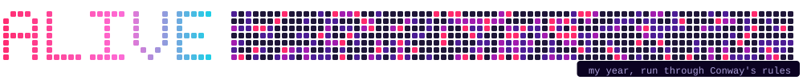

<picture><source media="(prefers-color-scheme: dark)" srcset="assets/year-dark.svg"><source media="(prefers-color-scheme: light)" srcset="assets/year-light.svg"></picture>

<sub>Frame 0 is my real calendar. Then Conway's Game of Life takes over: survivors get brighter, newborns start dim, crowded squares go dark. Then it loops.</sub>

<a name="the-wall"></a>

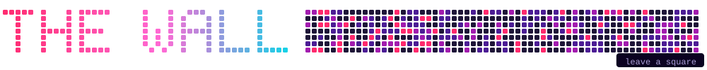

<a href="https://github.com/Kaushik2210/Kaushik2210/issues/new?template=square.yml"><picture><source media="(prefers-color-scheme: dark)" srcset="assets/wall-dark.svg"><source media="(prefers-color-scheme: light)" srcset="assets/wall-light.svg">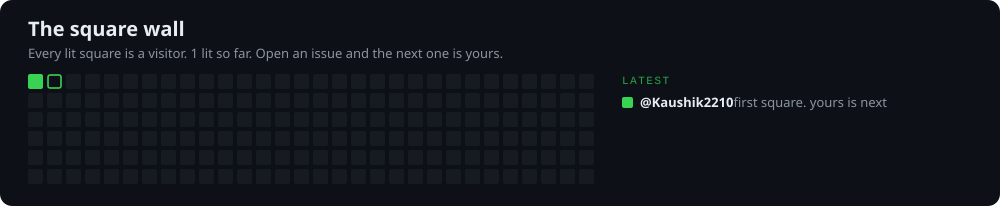</picture></a>

<div align="center">

**[🟩 Light your square →](https://github.com/Kaushik2210/Kaushik2210/issues/new?template=square.yml)** &nbsp; Pick a shade, leave a message, and a bot puts your handle on the wall.

</div>

<a name="ctf"></a>

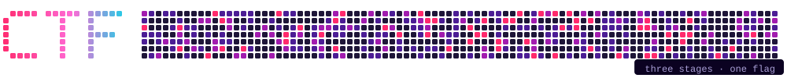


**A three-stage CTF is hidden in this profile.** Crack it and a bot adds you to the Hall of Fame.

```text
STAGE 1 / 3   (base64)
U1RBR0UgMS8zIDo6IG5pY2UsIHlvdSBkZWNvZGVkIGJhc2U2NC4gdGhlIGNpdHkgaXMgbW9yZSB0aGFuIGEgcGljdHVyZTogb3BlbiBhc3NldHMvY2l0eS5zdmcgYXMgcmF3IHRleHQgYW5kIHJlYWQgaXRzIDxkZXNjPiBlbGVtZW50LiBpdCBpcyBoZXgu
```

<details>
<summary><b>Rules and how to submit</b></summary>

<br>

- Each stage leads to the next. The final answer is a flag shaped like `KAUSHIK{...}`.
- **Don't post the flag.** Issues are public. Submit a *proof* bound to your login instead:
  ```bash
  echo -n "KAUSHIK{the_flag_you_found}:your-github-login" | sha256sum | cut -c1-12
  ```
  (login in lowercase, 12 hex characters out.) A leaked proof is useless to anyone else.
- [**Submit your proof**](https://github.com/Kaushik2210/Kaushik2210/issues/new?template=ctf.yml). An Action checks it and, if it's right, adds you below within a minute.
- No brute force needed. Everything you need is in this repo and my other repos' names.

</details>

**Hall of Fame**

<!--HOF_START-->
| # | operator | cracked on |
|:-:|:--|:--|
| 🥇 | [@renuthomas](https://github.com/renuthomas) | 2026-10-29 |
<!--HOF_END-->

<a name="stack"></a>

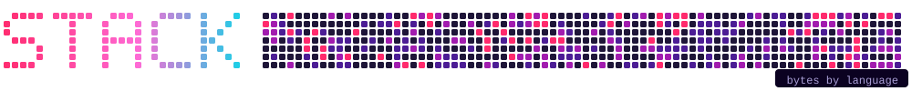

<picture><source media="(prefers-color-scheme: dark)" srcset="assets/stack-dark.svg"><source media="(prefers-color-scheme: light)" srcset="assets/stack-light.svg"></picture>

<sub>**Toolbox:** React · Next.js · Node · FastAPI · Supabase · Tailwind · Docker · Zeek & Suricata · MITRE ATT&CK · LLM agents & tool calling · Chrome extensions · GitHub Actions</sub>

<a name="hire-me"></a>

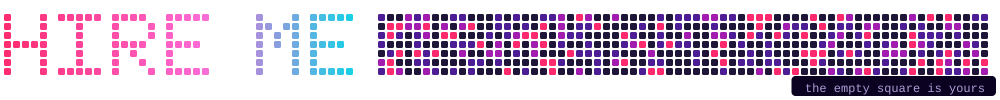

<a href="https://www.linkedin.com/in/sodagum-venkata-kaushik-3497a4248/"><picture><source media="(prefers-color-scheme: dark)" srcset="assets/hire-dark.svg"><source media="(prefers-color-scheme: light)" srcset="assets/hire-light.svg"></picture></a>

<div align="center">

**Have a project?** [Message me on LinkedIn](https://www.linkedin.com/in/sodagum-venkata-kaushik-3497a4248/) · [open a hello issue](https://github.com/Kaushik2210/Kaushik2210/issues/new?template=hello.yml) · [see the portfolio](https://portfolio-general-ten.vercel.app)

<br>

<sub>Every square, tower and pixel here is drawn from live GitHub data by <a href="scripts">a few Python scripts</a> and redrawn every 6 hours.<br>
Standing on the shoulders of the community's best profiles: <a href="https://github.com/timburgan">timburgan</a>'s issue-driven chess, <a href="https://github.com/Andrew6rant">Andrew6rant</a>'s neofetch card, <a href="https://github.com/jasonlong">jasonlong</a>'s isometric graph and <a href="https://github.com/kautukkundan">kautukkundan</a>'s Game of Life.</sub>

</div>
