<div align="center">


**I build security tooling and AI-era developer products, then ship them as live demos.**

<a href="https://portfolio-general-ten.vercel.app">Portfolio</a> &nbsp;·&nbsp; <a href="https://www.linkedin.com/in/sodagum-venkata-kaushik-3497a4248/">LinkedIn</a> &nbsp;·&nbsp; <a href="https://x.com/svKaushik2210">X</a> &nbsp;·&nbsp; <a href="https://github.com/Kaushik2210?tab=repositories">Repositories</a>

<br/>


</div>

<!--BUILDS_START-->
<div align="center">

<a href="https://github.com/Kaushik2210/Net-Sentinel"></a> <a href="https://github.com/Kaushik2210/ORBITAL-SENTINEL"></a> <a href="https://github.com/Kaushik2210/scam-khel"></a> <a href="https://github.com/Kaushik2210/Deepfake-Detector"></a> <a href="https://tapwire-xi.vercel.app"></a> <a href="https://kaushik2210.github.io/gitVisualise/"></a> <a href="https://hireos-beryl.vercel.app">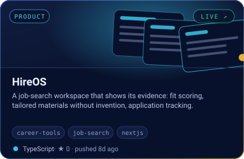</a> <a href="https://algoverse-lovat-seven.vercel.app"></a>

<sub>Tap a card to open the live demo or the repository. Cover art is generated from each repo's name; language, stars and last push update automatically.</sub>

</div>

<details>
<summary><b>More builds (20)</b></summary>

| Build | Stack | What it is |
|:--|:--|:--|
| [**cp-sysdesign-academy**](https://github.com/Kaushik2210/cp-sysdesign-academy) | `MDX` | Open-source interactive course: competitive programming and system design (static site, runs in the… |
| [**daily-automation-scripts**](https://github.com/Kaushik2210/daily-automation-scripts) | `Python` | 30-day challenge: 300 small, tested, cross-platform automation scripts in Python (files, PDFs… |
| [**Ember-Line**](https://github.com/Kaushik2210/Ember-Line) · [live](https://emberline-zeta.vercel.app) | `Python` | One consistent record of fire, from two sensors: harmonized MODIS + VIIRS active-fire calendar with… |
| [**100-days-of-java**](https://github.com/Kaushik2210/100-days-of-java) | `Java` | 100 days of Java: from Hello World to data structures, algorithms and interview prep. Daily notes… |
| [**Overrank**](https://github.com/Kaushik2210/Overrank) · [live](https://overrank.vercel.app) | `TypeScript` | Live house-competition platform for campuses: teams earn points, the leaderboard reacts in real… |
| [**Learn_python-**](https://github.com/Kaushik2210/Learn_python-) | `Python` | Python course as Jupyter notebooks: explanations, 108 challenge problems, exam prep and projects… |
| [**learn-os**](https://github.com/Kaushik2210/learn-os) | `TypeScript` | A gamified, interactive Operating Systems learning platform — from first principles to… |
| [**ATTESTA---AI-powered-SOC-**](https://github.com/Kaushik2210/ATTESTA---AI-powered-SOC-) | `TypeScript` | Multi-tenant Autonomous SOC platform with reproducible, re-adjudicable verdicts — a deterministic… |
| [**PORTCULLIS**](https://github.com/Kaushik2210/PORTCULLIS) | `Python` | Adversarial prompt injection detection gateway for LLM applications |
| [**GLYPHFORGE**](https://github.com/Kaushik2210/GLYPHFORGE) · [live](https://glyphforge-web.vercel.app) | `TypeScript` | A GPU-native ASCII art engine for the browser. Converts photos into character grids via perceptual… |
| [**SCRB-Crime-Intelligence-Analytics-Platform**](https://github.com/Kaushik2210/SCRB-Crime-Intelligence-Analytics-Platform) | `JavaScript` | An AI-driven crime analytics and visualization platform for the Karnataka State Police State Crime… |
| [**SafeRoute**](https://github.com/Kaushik2210/SafeRoute) | `JavaScript` | Safe Route for women safety |
| [**SafePath**](https://github.com/Kaushik2210/SafePath) | `TypeScript` | Safe Path detecter for women |
| [**PowerBI-dashboard**](https://github.com/Kaushik2210/PowerBI-dashboard) | `misc` | PowerBI dashboard |
| [**Church_Grace**](https://github.com/Kaushik2210/Church_Grace) | `misc` | prototype |
| [**Research-Visualizer**](https://github.com/Kaushik2210/Research-Visualizer) | `TypeScript` | built a research visualizer with cool visuals and representations from google gemini 3.0 using… |
| [**Celeb-Bomb**](https://github.com/Kaushik2210/Celeb-Bomb) | `TypeScript` | Created a website that can generate a selfie or an image with a celebrity on random uses nano… |
| [**Photo-Video-Editor**](https://github.com/Kaushik2210/Photo-Video-Editor) | `TypeScript` | Used google AI studio in order to generate a beautiful webpage for generating editing images and… |
| [**cybernetics_website**](https://github.com/Kaushik2210/cybernetics_website) | `HTML` | website for the cybernetics association 24-25 |
| [**website_anime_design**](https://github.com/Kaushik2210/website_anime_design) | `JavaScript` | a fully responsive website featuring a 3D animated male anime character with transitions! |

</details>
<!--BUILDS_END-->

<div align="center">


<a href="https://github.com/Kaushik2210?tab=repositories"></a>

<sub>Rebuilt from my avatar on every run. The numbers beside it come straight from the GitHub API.</sub>



<sub>Three live gauges: how consistent I am, when in the day I ship, and how this quarter compares to the last.</sub>


<a href="https://github.com/Kaushik2210?tab=repositories&sort=updated"></a>

<sub>Every repo is a neuron, wired to the ones it shares topics, a name family or a language with. Rings mark what I pushed this week.</sub>



<sub>My last two weeks of pushes, one lane per repo. Taller bar, busier window. The table below has the details.</sub>

</div>

<!--OPS_START-->
| Repo | Stack | Last push | Brief |
|:--|:--|:--|:--|
| [**HireOS**](https://github.com/Kaushik2210/HireOS) · [live](https://hireos-beryl.vercel.app) | `TypeScript` | today | Job-search workspace that shows its evidence: fit scoring, tailored materials without… |
| [**cp-sysdesign-academy**](https://github.com/Kaushik2210/cp-sysdesign-academy) | `MDX` | today | Open-source interactive course: competitive programming and system design (static site, runs in… |
| [**ORBITAL-SENTINEL**](https://github.com/Kaushik2210/ORBITAL-SENTINEL) | `Python` | today | Space-mission cybersecurity & anomaly detection: tell cyberattacks apart from sensor faults… |
| [**daily-automation-scripts**](https://github.com/Kaushik2210/daily-automation-scripts) | `Python` | today | 30-day challenge: 300 small, tested, cross-platform automation scripts in Python (files, PDFs… |
| [**scam-khel**](https://github.com/Kaushik2210/scam-khel) | `Python` | today | Private family shield against Indian digital-arrest scams: live detection, simulated honeypot… |
| [**Ember-Line**](https://github.com/Kaushik2210/Ember-Line) · [live](https://emberline-zeta.vercel.app) | `Python` | today | One consistent record of fire, from two sensors: harmonized MODIS + VIIRS active-fire calendar… |
| [**100-days-of-java**](https://github.com/Kaushik2210/100-days-of-java) | `Java` | yesterday | 100 days of Java: from Hello World to data structures, algorithms and interview prep. Daily… |
| [**Hivora**](https://github.com/Kaushik2210/Hivora) | `misc` | 11d ago | _Still cooking._ |
<!--OPS_END-->

<div align="center">


<a href="https://github.com/Kaushik2210/Kaushik2210/issues/new?template=star.yml"></a>

<sub>One star per day for the last year; the core is today.<br/><b><a href="https://github.com/Kaushik2210/Kaushik2210/issues/new?template=star.yml">Add your own star</a></b>: pick a colour and your handle orbits here too.</sub>


<a href="https://badger.github.io/virtual/?u=Kaushik2210"></a>

<sub>My own badge, rebuilt from live data. <b><a href="https://badger.github.io/virtual/?u=Kaushik2210">Open it on the virtual badge</a></b> (GitHub's DOOM-on-a-badge page) to play with my avatar on screen.</sub>


**A three-stage CTF is hidden in this profile.** Crack it and you join the Hall of Fame below, automatically.

</div>

```text
STAGE 1 / 3   (base64)
U1RBR0UgMS8zIDo6IG5pY2UsIHlvdSBkZWNvZGVkIGJhc2U2NC4gdGhlIHJlcG8gbWFwIGlzIG1vcmUgdGhhbiBhIHBpY3R1cmU6IG9wZW4gYXNzZXRzL25ldXJhbC5zdmcgYXMgcmF3IHRleHQgYW5kIHJlYWQgaXRzIDxkZXNjPiBlbGVtZW50LiBpdCBpcyBoZXgu
```

<details>
<summary><b>Rules and how to submit</b></summary>

<br/>

- Each stage leads to the next. The final answer is a flag shaped like `KAUSHIK{...}`.
- **Don't post the flag.** Issues are public. Submit a *proof* bound to your login instead:
  ```bash
  echo -n "KAUSHIK{the_flag_you_found}:your-github-login" | sha256sum | cut -c1-12
  ```
  (login in lowercase, 12 hex characters out.) A leaked proof is useless to anyone else.
- [**Submit your proof**](https://github.com/Kaushik2210/Kaushik2210/issues/new?template=ctf.yml). An Action checks it and, if it's right, adds you below within a minute.
- No brute force needed. Everything you need is in this repo and my other repos' names.

</details>

<div align="center">

**Hall of Fame**

</div>

<!--HOF_START-->
| # | operator | cracked on |
|:-:|:--|:--|
| 🥇 | [@renuthomas](https://github.com/renuthomas) | 2026-10-29 |
<!--HOF_END-->

<br/>

<div align="center">


<br/><br/>


<br/><br/>

<sub>Every chart above is generated from my GitHub data by scripts in this repo and rebuilt every six hours.</sub>

</div>
