<div align="center">



<sub>The sky above my skyline is Bangalore's real sky right now: live time of day and weather, redrawn through the day. Come back at sunset.</sub>

**I build security tooling and AI-era developer products, then ship them as live demos.**

<a href="https://portfolio-general-ten.vercel.app">Portfolio</a> &nbsp;·&nbsp; <a href="https://www.linkedin.com/in/sodagum-venkata-kaushik-3497a4248/">LinkedIn</a> &nbsp;·&nbsp; <a href="https://x.com/svKaushik2210">X</a> &nbsp;·&nbsp; <a href="https://github.com/Kaushik2210?tab=repositories">Repositories</a> &nbsp;·&nbsp; <a href="https://github.com/Kaushik2210/Kaushik2210/issues/new?template=hello.yml">Say hello</a>

<sub><a href="#work">Work</a> &nbsp;›&nbsp; <a href="#activity">Activity</a> &nbsp;›&nbsp; <a href="#interactive">Interactive</a> &nbsp;›&nbsp; <a href="#shell">Shell</a></sub>

<sub>Try it: <a href="#shell">type into my terminal</a> &nbsp;·&nbsp; <a href="https://badger.github.io/virtual/?u=Kaushik2210">play on my badge</a> &nbsp;·&nbsp; <a href="#interactive">crack the CTF</a> &nbsp;·&nbsp; <a href="https://github.com/Kaushik2210/Kaushik2210/issues/new?template=hello.yml">say hello</a></sub>

<br/>

<a href="https://github.com/Kaushik2210?tab=repositories"></a>

<!--NOW_START-->
**Now:** shipping [aiforge](https://github.com/Kaushik2210/aiforge) (TypeScript, pushed today). Open-source, gamified academy for becoming a production-ready AI engineer
<!--NOW_END-->

</div>

<div align="center">

## Work


</div>

<table width="100%">
<tr>
<td width="33%" valign="top">

**Security that shows its work**

Detection systems that explain themselves. [Net-Sentinel](https://github.com/Kaushik2210/Net-Sentinel) maps attacks to MITRE ATT&CK, [ORBITAL-SENTINEL](https://github.com/Kaushik2210/ORBITAL-SENTINEL) tells cyberattacks from sensor faults in spacecraft telemetry, [Deepfake-Detector](https://github.com/Kaushik2210/Deepfake-Detector) returns calibrated probabilities instead of a verdict, and [scam-khel](https://github.com/Kaushik2210/scam-khel) shields families from digital-arrest scams.

</td>
<td width="33%" valign="top">

**Tools for the AI-agent era**

Guardrails and visibility for people building with agents. [tapwire](https://github.com/Kaushik2210/tapwire) turns an agent's mistakes into enforced rules and measures how often they repeat, [gitVisualise](https://github.com/Kaushik2210/gitVisualise) turns any repo into a narrated architecture tour (site, CLI and GitHub Action), and [PORTCULLIS](https://github.com/Kaushik2210/PORTCULLIS) screens LLM apps for prompt injection.

</td>
<td width="33%" valign="top">

**Products that ship**

Things people can open and use today. [HireOS](https://hireos-beryl.vercel.app) is a job-search workspace that shows its evidence, [AlgoVerse](https://algoverse-lovat-seven.vercel.app) is interview prep with 635+ explained solutions, and [Overrank](https://overrank.vercel.app) runs a live campus leaderboard.

</td>
</tr>
</table>

<div align="center">


</div>

<!--BUILDS_START-->
<div align="center">

<a href="https://github.com/Kaushik2210/Net-Sentinel"></a> <a href="https://github.com/Kaushik2210/ORBITAL-SENTINEL"></a> <a href="https://github.com/Kaushik2210/scam-khel"></a> <a href="https://github.com/Kaushik2210/Deepfake-Detector"></a> <a href="https://kaushik2210.github.io/IntentGuard/"></a> <a href="https://tapwire-xi.vercel.app"></a> <a href="https://kaushik2210.github.io/gitVisualise/"></a> <a href="https://hireos-beryl.vercel.app"></a> <a href="https://algoverse-lovat-seven.vercel.app"></a>

<sub>Tap a card to open the live demo or the repository. Cover art is generated from each repo's name; language, stars and last push update automatically.</sub>

</div>

<details>
<summary><b>More builds (20)</b></summary>

**Security & AI**

| Build | Stack | What it is |
|:--|:--|:--|
| [**PORTCULLIS**](https://github.com/Kaushik2210/PORTCULLIS) | `Python` | Adversarial prompt injection detection gateway for LLM applications |
| [**ATTESTA**](https://github.com/Kaushik2210/ATTESTA---AI-powered-SOC-) | `TypeScript` | Multi-tenant Autonomous SOC platform with reproducible, re-adjudicable verdicts — a deterministic… |
| [**SCRB Crime Intelligence Analytics**](https://github.com/Kaushik2210/SCRB-Crime-Intelligence-Analytics-Platform) | `JavaScript` | An AI-driven crime analytics and visualization platform for the Karnataka State Police State Crime Records… |
| [**SafeRoute**](https://github.com/Kaushik2210/SafeRoute) | `JavaScript` | Safe-route app for women's safety, built with React and Vite. |
| [**SafePath**](https://github.com/Kaushik2210/SafePath) | `TypeScript` | Safe-path detector for women's safety, built in Google AI Studio with Firebase and TypeScript. |

**Web & product experiments**

| Build | Stack | What it is |
|:--|:--|:--|
| [**Overrank**](https://github.com/Kaushik2210/Overrank) · [live](https://overrank.vercel.app) | `TypeScript` | Live house-competition platform for campuses: teams earn points, the leaderboard reacts in real time, faculty… |
| [**GLYPHFORGE**](https://github.com/Kaushik2210/GLYPHFORGE) · [live](https://glyphforge-web.vercel.app) | `TypeScript` | A GPU-native ASCII art engine for the browser. Converts photos into character grids via perceptual… |
| [**Research-Visualizer**](https://github.com/Kaushik2210/Research-Visualizer) | `TypeScript` | Research-paper visualiser with rich visual representations, built with Google AI Studio and Gemini 3.0. |
| [**Celeb-Bomb**](https://github.com/Kaushik2210/Celeb-Bomb) | `TypeScript` | Web app that generates a selfie or image with a celebrity at random, built with Google AI Studio and Gemini… |
| [**Photo-Video-Editor**](https://github.com/Kaushik2210/Photo-Video-Editor) | `TypeScript` | Web app for editing images and videos, built with Google AI Studio and Gemini 3.0. |
| [**cybernetics_website**](https://github.com/Kaushik2210/cybernetics_website) | `HTML` | Website for the Cybernetics Association, 2024-25. |
| [**website_anime_design**](https://github.com/Kaushik2210/website_anime_design) | `JavaScript` | Fully responsive website featuring a 3D animated anime character with transitions. |

**Learning & practice**

| Build | Stack | What it is |
|:--|:--|:--|
| [**daily-automation-scripts**](https://github.com/Kaushik2210/daily-automation-scripts) | `Python` | 30-day challenge: 300 small, tested, cross-platform automation scripts in Python (files, PDFs, GitHub, email… |
| [**100-days-of-java**](https://github.com/Kaushik2210/100-days-of-java) | `Java` | 100 days of Java: from Hello World to data structures, algorithms and interview prep. Daily notes plus… |
| [**Learn Python**](https://github.com/Kaushik2210/Learn_python-) | `Python` | Python course as Jupyter notebooks: explanations, 108 challenge problems, exam prep and projects, from zero… |
| [**learn-os**](https://github.com/Kaushik2210/learn-os) | `TypeScript` | A gamified, interactive Operating Systems learning platform — from first principles to interview-ready… |
| [**cp-sysdesign-academy**](https://github.com/Kaushik2210/cp-sysdesign-academy) | `MDX` | Open-source interactive course: competitive programming and system design (static site, runs in the browser) |
| [**PowerBI-dashboard**](https://github.com/Kaushik2210/PowerBI-dashboard) | `misc` | Power BI dashboard for class attendance reporting. |

**More**

| Build | Stack | What it is |
|:--|:--|:--|
| [**aiforge**](https://github.com/Kaushik2210/aiforge) | `TypeScript` | Open-source, gamified academy for becoming a production-ready AI engineer |
| [**leetcode-study-studio**](https://github.com/Kaushik2210/leetcode-study-studio) | `JavaScript` | Chrome extension: LeetCode themes plus a learning layer (blind mode, hint ladder, spaced repetition, mistake… |

</details>
<!--BUILDS_END-->

<div align="center">

## Activity


<a href="https://github.com/Kaushik2210?tab=repositories"></a>

<sub>Rebuilt from my avatar on every run. The numbers beside it come straight from the GitHub API.</sub>


<a href="https://github.com/Kaushik2210?tab=repositories&sort=created"></a>

<sub>Every project I started this year, plotted like a launch. The higher it flies, the longer I kept building it. Green rings are live, gold is still in orbit.</sub>

<div align="center">

## Interactive

<a name="shell"></a>


</div>

<!--SHELL_START-->
<div align="center">

**A real shell on my profile that anyone can type into.** Pick a command, press *Create* on the issue that opens, and a bot answers you here within a minute.

<a href="https://github.com/Kaushik2210/Kaushik2210/issues/new?title=%5BSH%5D%20help&body=Just%20press%20%2A%2ACreate%2A%2A.%20The%20bot%20answers%20in%20this%20issue%20and%20adds%20your%20command%20to%20the%20terminal%20on%20the%20profile%20within%20a%20minute.%20You%20can%20also%20edit%20the%20title%20to%20type%20any%20command%20after%20%60%5BSH%5D%60."></a>

<a href="https://github.com/Kaushik2210/Kaushik2210/issues/new?title=%5BSH%5D%20help&body=Just%20press%20%2A%2ACreate%2A%2A.%20The%20bot%20answers%20in%20this%20issue%20and%20adds%20your%20command%20to%20the%20terminal%20on%20the%20profile%20within%20a%20minute.%20You%20can%20also%20edit%20the%20title%20to%20type%20any%20command%20after%20%60%5BSH%5D%60."><kbd>help</kbd></a> <a href="https://github.com/Kaushik2210/Kaushik2210/issues/new?title=%5BSH%5D%20whoami&body=Just%20press%20%2A%2ACreate%2A%2A.%20The%20bot%20answers%20in%20this%20issue%20and%20adds%20your%20command%20to%20the%20terminal%20on%20the%20profile%20within%20a%20minute.%20You%20can%20also%20edit%20the%20title%20to%20type%20any%20command%20after%20%60%5BSH%5D%60."><kbd>whoami</kbd></a> <a href="https://github.com/Kaushik2210/Kaushik2210/issues/new?title=%5BSH%5D%20ls&body=Just%20press%20%2A%2ACreate%2A%2A.%20The%20bot%20answers%20in%20this%20issue%20and%20adds%20your%20command%20to%20the%20terminal%20on%20the%20profile%20within%20a%20minute.%20You%20can%20also%20edit%20the%20title%20to%20type%20any%20command%20after%20%60%5BSH%5D%60."><kbd>ls</kbd></a> <a href="https://github.com/Kaushik2210/Kaushik2210/issues/new?title=%5BSH%5D%20cat%20IntentGuard&body=Just%20press%20%2A%2ACreate%2A%2A.%20The%20bot%20answers%20in%20this%20issue%20and%20adds%20your%20command%20to%20the%20terminal%20on%20the%20profile%20within%20a%20minute.%20You%20can%20also%20edit%20the%20title%20to%20type%20any%20command%20after%20%60%5BSH%5D%60."><kbd>cat IntentGuard</kbd></a> <a href="https://github.com/Kaushik2210/Kaushik2210/issues/new?title=%5BSH%5D%20stack&body=Just%20press%20%2A%2ACreate%2A%2A.%20The%20bot%20answers%20in%20this%20issue%20and%20adds%20your%20command%20to%20the%20terminal%20on%20the%20profile%20within%20a%20minute.%20You%20can%20also%20edit%20the%20title%20to%20type%20any%20command%20after%20%60%5BSH%5D%60."><kbd>stack</kbd></a> <a href="https://github.com/Kaushik2210/Kaushik2210/issues/new?title=%5BSH%5D%20fortune&body=Just%20press%20%2A%2ACreate%2A%2A.%20The%20bot%20answers%20in%20this%20issue%20and%20adds%20your%20command%20to%20the%20terminal%20on%20the%20profile%20within%20a%20minute.%20You%20can%20also%20edit%20the%20title%20to%20type%20any%20command%20after%20%60%5BSH%5D%60."><kbd>fortune</kbd></a> <a href="https://github.com/Kaushik2210/Kaushik2210/issues/new?title=%5BSH%5D%20sudo%20hire%20kaushik&body=Just%20press%20%2A%2ACreate%2A%2A.%20The%20bot%20answers%20in%20this%20issue%20and%20adds%20your%20command%20to%20the%20terminal%20on%20the%20profile%20within%20a%20minute.%20You%20can%20also%20edit%20the%20title%20to%20type%20any%20command%20after%20%60%5BSH%5D%60."><kbd>sudo hire kaushik</kbd></a>

<sub>Or open an issue titled <code>[SH] anything</code>. Nothing ever executes: it is a sandbox of answers about me. 1 visitor has typed here.</sub>

</div>
<!--SHELL_END-->

<div align="center">


<a href="https://badger.github.io/virtual/?u=Kaushik2210"></a>

<sub>My own badge, rebuilt from live data. <b><a href="https://badger.github.io/virtual/?u=Kaushik2210">Open it on the virtual badge</a></b> (GitHub's DOOM-on-a-badge page) to play with my avatar on screen.</sub>


**A three-stage CTF is hidden in this profile.** Crack it and you join the Hall of Fame below, automatically.

</div>

```text
STAGE 1 / 3   (base64)
U1RBR0UgMS8zIDo6IG5pY2UsIHlvdSBkZWNvZGVkIGJhc2U2NC4gdGhlIGxhdW5jaCBsb2cgaXMgbW9yZSB0aGFuIGEgcGljdHVyZTogb3BlbiBhc3NldHMvbGF1bmNoLnN2ZyBhcyByYXcgdGV4dCBhbmQgcmVhZCBpdHMgPGRlc2M+IGVsZW1lbnQuIGl0IGlzIGhleC4=
```

<details>
<summary><b>Rules and how to submit</b></summary>

<br/>

- Each stage leads to the next. The final answer is a flag shaped like `KAUSHIK{...}`.
- **Don't post the flag.** Issues are public. Submit a *proof* bound to your login instead:
  ```bash
  echo -n "KAUSHIK{the_flag_you_found}:your-github-login" | sha256sum | cut -c1-12
  ```
  (login in lowercase, 12 hex characters out.) A leaked proof is useless to anyone else.
- [**Submit your proof**](https://github.com/Kaushik2210/Kaushik2210/issues/new?template=ctf.yml). An Action checks it and, if it's right, adds you below within a minute.
- No brute force needed. Everything you need is in this repo and my other repos' names.

</details>

<div align="center">

**Hall of Fame**

</div>

<!--HOF_START-->
| # | operator | cracked on |
|:-:|:--|:--|
| 🥇 | [@renuthomas](https://github.com/renuthomas) | 2026-10-29 |
<!--HOF_END-->

<div align="center">

<sub>Every chart on this page is generated from my GitHub data by scripts in this repo and rebuilt every six hours.</sub>

</div>
